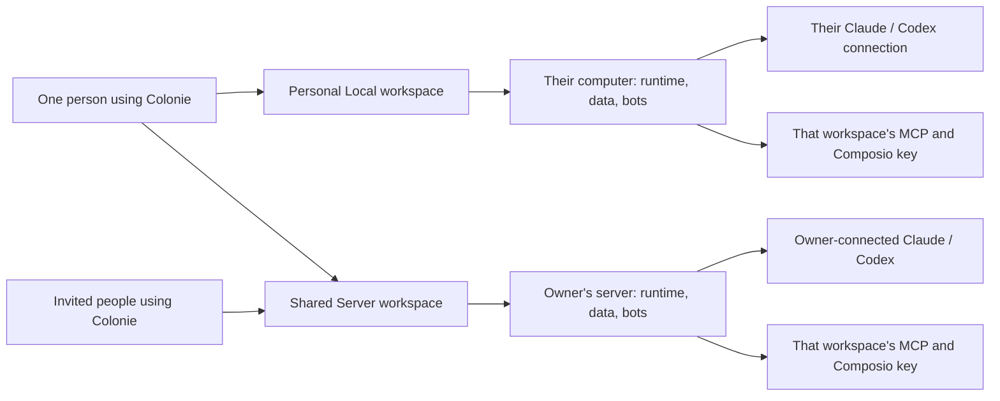
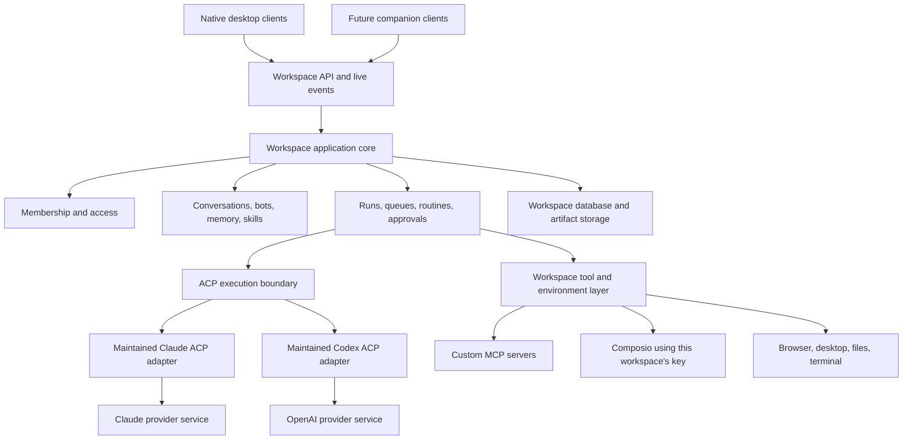
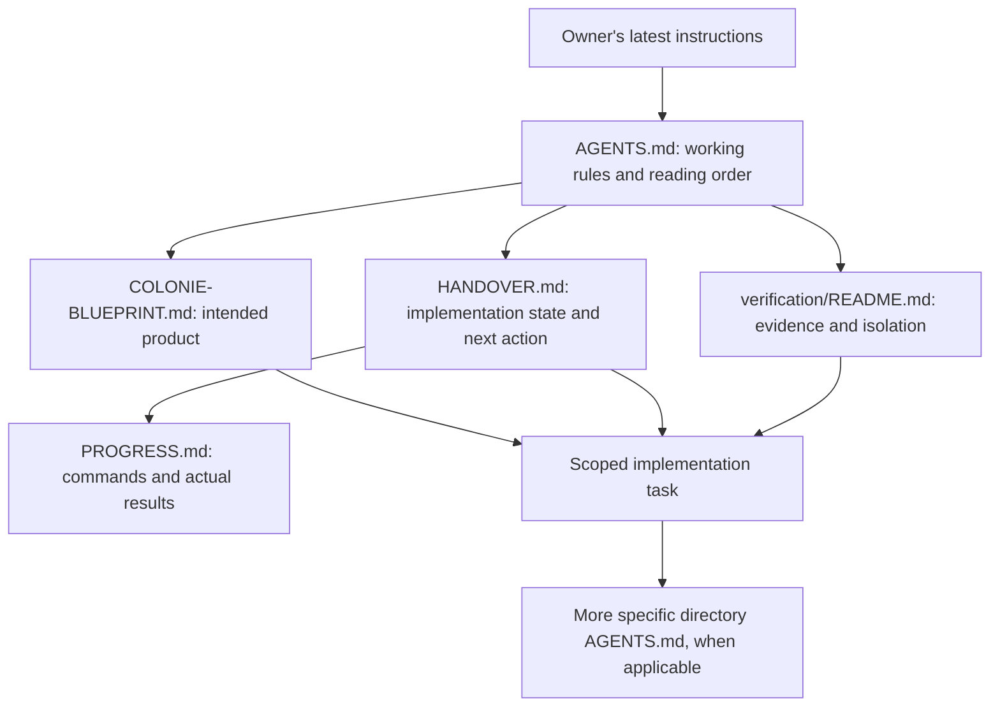

# Colonie product blueprint

Status: working draft for owner review. Last researched: October 16, 2026.

This document brings the intended product, reference research, architecture proposal, business model, and delivery plan into one place. It describes the destination while the repository is being cleaned up. Existing code and old upstream documentation do not define that destination.

Nothing here turns a provisional conversation into an irreversible decision. A documented competitor feature is not evidence that Colonie already implements it. Architecture and delivery recommendations remain proposals until reviewed.

## Contents

1. [Product direction](#1-product-direction)
2. [Research findings and limits](#2-research-findings-and-limits)
3. [Workspace model and journeys](#3-workspace-model-and-journeys)
4. [Capability inventory](#4-capability-inventory)
5. [Collaboration behavior](#5-collaboration-behavior)
6. [Architecture proposal](#6-architecture-proposal)
7. [Repository and instruction structure](#7-repository-and-instruction-structure)
8. [Commercial model, operating costs, and capacity](#8-commercial-model-operating-costs-and-capacity)
9. [Delivery plan and acceptance](#9-delivery-plan-and-acceptance)
10. [Open decisions and next work](#10-open-decisions-and-next-work)
11. [Source register](#11-source-register)

## 1. Product direction

Colonie is a native place where people and AI teammates gather, communicate, and get work done. Bots have identities, skills, memory, connected services, and access to tools and computers. People can work privately on their own computer or collaborate in a workspace running on infrastructure paid for by its owner.

The owner explicitly wants Grok Bot as the primary product reference. Its existing workflows should provide the starting point for discussion. The goal includes browser use, computer use, automation, collaboration, and companion access; these must remain visible throughout planning. Preserve the native UI the owner already likes.

### Reading the status labels

| Label | Meaning |
|---|---|
| Owner direction | Explicitly expressed by the owner; still revisable. |
| Reference behavior | Supported by a linked external source; not a claim about Colonie. |
| Proposal | A recommendation made during planning; not an owner decision. |
| Open | Requires a specific decision, provider clarification, or practical validation. |

### Owner direction register

| ID | Working direction |
|---|---|
| D01 | The product is named **Colonie** and should become independent of Colonie and Colonie. Preserve useful infrastructure and UX based on merit. |
| D02 | Keep the current native desktop experience as the starting point. |
| D03 | Bots have configurable names, personas/SOUL, and skills. |
| D04 | Support Claude Code and Codex through ACP and the maintained adapters, using the user's existing provider subscription where supported. |
| D05 | Provide predefined Composio integrations and user-configured custom MCP connections. |
| D06 | A person can create multiple independent workspaces and choose Local or Server for each. |
| D07 | Local workspaces are free and require no Colonie account. A name/email may be requested for the UI rather than authentication. Required fields remain open. |
| D08 | Creating a new Local workspace includes its own engine onboarding and Claude/Codex connection, even if that person already uses a Server workspace. |
| D09 | A Server workspace runs its agents, ACP adapters, integrations, and working environment on the owner's server. Members use that environment through Colonie. |
| D10 | The owner connects the workspace's Claude/Codex. Invited members can use its bots without connecting their own provider subscription. Provider support for this commercial arrangement still needs validation. |
| D11 | MCP connections belong to the workspace. Personal integrations should live in a person's separate workspace rather than a personal overlay inside a shared workspace. |
| D12 | Composio credentials are also user-supplied and configured per workspace. Different workspaces can use different Composio API keys/accounts; their service costs belong to those accounts. Colonie can supply the integration catalog and setup UI. |
| D13 | Server workspaces support invited humans, bots as members, direct conversations, and project groups containing both. Human messaging is part of the collaboration experience. Local workspaces are personal in the current direction. |
| D14 | The intended Server journey is guided deployment for nontechnical owners, ideally one click after the necessary provider authorization. Infrastructure is paid for by the owner. |
| D15 | The commercial direction is a one-time Colonie purchase per Server workspace. Two separate Server workspaces would require two purchases. Pricing and terms remain provisional. |
| D16 | Members should not need another Colonie purchase to accept an invitation. Local workspace creation remains free. |
| D17 | Show ongoing compute usage so owners can understand when an upgrade is useful. Upgrades should be understandable to nontechnical people. |
| D18 | Grok Bot is the default feature/behavior reference, including computer use, browser use, automation, and companion capabilities. Extend its model where Colonie's human collaboration and workspace ownership require it. |

### Deliberate differences from the reference

These differences are part of the intended product rather than accidental omissions.

| Area | Colonie direction | Reference context |
|---|---|---|
| Product identity and UI | Independent Colonie brand; preserve the native UI the owner likes. | Reuse the interaction ideas, not another product's identity. |
| Execution engine | Owner-supplied Claude Code/Codex through ACP. | Grok Bot manages its own model experience. [Settings](https://cursor.com/docs/grok-bot/settings) |
| Bot profile | Keep editable persona/SOUL and skills. | Current Grok personal-bot settings have changed; names/avatars remain while behavioral instructions can be saved through conversation. Copying its latest screen removal would conflict with D03. [Editing bots](https://cursor.com/help/grok-bot/edit-bot) |
| Ownership and billing | Workspace-owned environment; owner pays infrastructure and connects AI. | Grok TeamBots have per-person chats, plugin overlays, and reader usage accounting. [TeamBots](https://prod.cursor.com/help/grok-bot/team-bots) |
| Integrations | Workspace-scoped MCP and user-supplied Composio key. | Do not copy personal connector overlays into shared workspaces. |
| Local access | Free, no Colonie account required. | Grok Bot's ongoing access depends on an eligible paid plan. [Plans](https://cursor.com/help/grok-bot/plans) |
| Hosting | Owner-funded infrastructure with guided provisioning. | Grok provides a managed cloud computer. [Overview](https://cursor.com/docs/grok-bot) |

## 2. Research findings and limits

### What the reference actually validates

Grok Bot documents persistent bots working with a browser, filesystem, terminal, and a shared computer. It also documents groups, delegation, routines, connected services, voice, mobile access, and recovery. The relevant baseline is a working assistant environment with a messaging interface. [Product overview](https://cursor.com/docs/grok-bot)

Its ongoing product access is paid, but there are trial allowances and eligible subscription bundles. Therefore, “no permanent free Bot tier” is more accurate than “no free access of any kind.” Colonie's one-time purchase plus existing subscriptions is a positioning hypothesis; it is not automatically cheaper for every customer already receiving Grok Bot in a bundle. [Current access and plans](https://cursor.com/help/grok-bot/plans)

Public adoption reports and customer stories are useful demand signals. They do not establish paid conversion, revenue, retention, profitability, or demand specifically for Colonie's owner-hosted model. The reviewed Bloomberg report describes 418,000 weekly users, rather than 418,000 paying customers. [Bloomberg reporting via Bloomberg Technoz](https://www.bloombergtechnoz.com/detail-news/122463/agen-ai-grok-bot-elon-musk-diserbu-400-000-pengguna-dalam-sepekan)

### Research method

This is a documentation review, not a hands-on evaluation of a paid Grok Bot installation. Primary product/help pages are the main evidence; dated staff forum answers fill custom-MCP gaps. Colonie documentation is a secondary discovery reference for useful capabilities the owner may not have encountered. It does not dictate Colonie's architecture.

Documentation changes and rollouts can disagree. For example, older template instructions refer to settings that newer bot-editing guidance has removed. Preserve the intended capability, record the source/date, and verify the actual interaction before claiming exact parity. No competitor documentation establishes Colonie's implementation status.

### Three important feasibility boundaries

1. **ACP connects an application to an agent.** Its session setup supports working directories and MCP configuration. It does not supply workspace accounts, invitations, billing, schedules, speech, or a remote desktop. Those are Colonie responsibilities or separate integrations. [ACP session setup](https://agentclientprotocol.com/protocol/v1/session-setup)
2. **Native subscription authentication is different from a shared commercial entitlement.** Headless authentication and adapter availability do not prove that one owner's subscription can support all invited humans under every provider plan. Keep the intended journey, but validate the supported arrangement before selling that promise. [OpenAI authentication](https://learn.chatgpt.com/docs/auth), [Claude plan use with the Agent SDK](https://support.claude.com/en/articles/15036540-use-the-claude-agent-sdk-with-your-claude-plan)
3. **Free Local software does not make external services free.** The user supplies AI access, Composio credentials, and any other paid service needed by the chosen capability. Composio publishes free allowances and paid usage; its limits are separate from Colonie pricing. [Composio pricing](https://composio.dev/pricing)

## 3. Workspace model and journeys

### What a workspace owns

**Owner direction:** the workspace is the boundary for its environment, bots, conversations, integrations, Composio configuration, and provider setup.

**Proposal:** make the workspace the persistent logical unit with a stable ID. A workspace's identity should survive server replacement, backup restoration, and resizing. Whether every Server workspace initially gets its own VM is a provisioning decision, not the definition of a workspace.

| Property | Local workspace | Server workspace |
|---|---|---|
| Runs on | The person's computer | Infrastructure paid for by the owner |
| Colonie access | Free | Proposed one-time purchase per workspace |
| Human collaboration | Personal workspace in the current direction | Owner invites members |
| Profile/account | Local display profile; no Colonie signup | Authenticated membership; account architecture open |
| Claude/Codex | Set up for that workspace | Owner connects on the server; members use workspace bots |
| Composio | User supplies that workspace's key | Owner supplies that workspace's key |
| Custom MCP | Configured for that workspace | Configured for that workspace and reachable from its server |
| Working files and browser | On its selected local environment | On its selected server environment |
| When desktop is closed | Work depends on the local runtime staying available | Server work can continue while client apps are closed |
| Personal email/tools | Connect here for personal work | Shared workspace connections follow workspace access policy |

Local describes where execution and persistence live. Claude/Codex and connected services may still use the internet. It does not mean offline AI.



### Journey J01: first Local workspace

1. Download and open Colonie.
2. Choose to create a workspace and select Local.
3. Name the workspace and provide a local display profile if requested.
4. Connect Claude Code and/or Codex using the supported native authentication flow.
5. Create or choose a bot; configure its identity, persona, and skills.
6. Start work. Add Composio or custom MCP only when needed; these are not prerequisites for a basic chat.

No Colonie account or Colonie payment is required. Secrets should use protected setup fields or provider-owned authentication, rather than chat messages.

### Journey J02: owner creates a Server workspace

1. Download Colonie and choose Create workspace → Server.
2. See what the Colonie purchase covers and which recurring services the owner pays separately.
3. Authorize an infrastructure account or use a supported connection to an existing server. Select an understandable starting configuration.
4. Start guided deployment. Show progress, retryable failures, and how to remove an incomplete deployment without guessing which resources were created.
5. Connect Claude Code/Codex on the server using a supported headless authentication journey.
6. Add the workspace's Composio key and/or custom MCP as needed.
7. Create bots, invite people, and create project groups.

“One click” describes the provisioning step after required authorization. Provider signup, billing authorization, AI sign-in, and a service's consent screen cannot be assumed to disappear. The exact purchase/setup order remains a UX proposal.

### Journey J03: member accepts an invitation

1. Open the invite and authenticate as the intended person.
2. Install/open Colonie and arrive in the invited workspace.
3. See the bots and conversations available to that membership.
4. Use existing bots and workspace connections immediately, without buying Colonie or connecting a personal AI subscription.

Deep-link handling, expired invitations, revocation, and an already-installed app must be covered. The member is joining an existing environment, not provisioning another server.

### Journey J04: a member wants personal automation

Create a new Local workspace and go through its own Claude/Codex onboarding. Supply that workspace's own Composio key or custom MCP, connect personal email there, and create the routine there. The shared workspace's connections and history are not automatically imported.

### Journey J05: switch, resume, and recover

The workspace switcher makes the active workspace and execution location clear. Returning to a workspace restores its conversations and actual work status. If its runtime is offline, the UI says so rather than suggesting an agent is working. Recovery distinguishes restarting a process, restoring a backup, and rebuilding a computer.

**Open:** whether Local ↔ Server migration is offered initially, which data migrates, and which authorizations must be repeated. Do not silently equate migration with creating an unrelated workspace or transferring every secret.

## 4. Capability inventory

This is a target coverage map, not a release checklist claiming everything is implemented. **Core** means central to the intended product. **Catalog** means a discovered capability retained for an explicit scope decision. A later phase is sequencing, not automatic rejection.

| ID | Capability | Colonie target and reference evidence | Scope |
|---|---|---|---|
| F01 | Native desktop home | Preserve the liked native experience, workspace switcher, accessible appearance, keyboard navigation, and clear work status. Reference preferences and update surfaces are documented in [Grok settings](https://cursor.com/docs/grok-bot/settings). | Core |
| F02 | Bot identity and persona | Name, avatar, role/persona/SOUL, skills, and understandable configuration. Preserve owner direction even where current Grok personal settings differ. [Bot editing](https://cursor.com/help/grok-bot/edit-bot) | Core |
| F03 | Persistent bot memory | Bots retain useful context; people can understand and correct saved knowledge. Keep workspace-shared knowledge distinct from conversation access. Editable memory is also listed by [Colonie](https://docs.colonie.com/docs/features). | Core |
| F04 | Conversations and work history | Persistent chats/tasks, live responses, tool activity, attachments, and readable results. [Working with Grok Bot](https://prod.cursor.com/docs/grok-bot/work) | Core |
| F05 | Conversation controls | Search, replies, reactions, pins, organization, unread/attention state, and hide/restore. Reference organization is described in [How-to guidance](https://cursor.com/help/grok-bot/how-to). | Core |
| F06 | Editing and portability | Edit/branch/rewind, export/share content, and multiple tasks per bot are useful discovery items. Provider session semantics must be respected. [Colonie feature map](https://docs.colonie.com/docs/features) | Catalog |
| F07 | Human and bot groups | Project conversations containing humans and bots, targeted mentions, and observable bot participation. Human membership is a Colonie extension of the [Grok group baseline](https://prod.cursor.com/help/grok-bot/group-chats). | Core |
| F08 | Bot delegation | Bots can request help and pass work to another bot. Preserve visibility of who is working and where a result appears. Grok handoffs can appear in separate chats. [Group behavior](https://prod.cursor.com/help/grok-bot/group-chats) | Core |
| F09 | Steering and interruption | People can follow activity, send steering messages, and stop work. Completed side effects are not undone by Stop. Exact cancellation of delegated work needs a Colonie contract. [Work controls](https://prod.cursor.com/docs/grok-bot/work) | Core |
| F10 | Questions and approvals | Clear pending questions/actions, decision ownership, expiry/recovery behavior, and attention notifications. [Grok how-to](https://cursor.com/help/grok-bot/how-to), [Security](https://prod.cursor.com/docs/grok-bot/security) | Core |
| F11 | Browser use | Bots navigate sites and perform browser work; users can inspect and take over for login or difficult steps. A browser is a runtime capability, not something ACP automatically creates. [Grok computer overview](https://cursor.com/docs/grok-bot) | Core |
| F12 | Computer use | Desktop observation/control, screenshots, app interaction, and human takeover in a defined environment. Shared desktop contention and host permissions require explicit handling. [Grok overview](https://cursor.com/docs/grok-bot) | Core |
| F13 | Files and terminal | Work with documents/files, execute supported commands, produce artifacts, and preserve working state. Downloads and task outputs need a clear home. [Grok overview](https://cursor.com/docs/grok-bot) | Core |
| F14 | Skills and teaching | Reusable procedures; capture a demonstrated workflow, review it, and test it before recurring use. [Working and learning](https://prod.cursor.com/docs/grok-bot/work) | Core |
| F15 | Predefined integrations | A simple service catalog backed by the workspace's user-supplied Composio key, with connect/reconnect/disconnect and account labels. Reference plugin lifecycle: [Connect plugins](https://prod.cursor.com/help/grok-bot/connect-plugins). | Core |
| F16 | Custom MCP | Add user-selected servers and inspect connection/tool availability. Local commands and remote endpoints have different deployment needs. Dated staff confirmation: [Custom MCP](https://forum.cursor.com/t/grokbot-custom-connectors/169965/5), [Sharing custom MCP](https://forum.cursor.com/t/how-do-i-share-a-custom-mcp-that-one-of-my-bots-has-built-with-the-rest-of-my-team/173538). | Core |
| F17 | Credentials and service login | Protected secret entry, reconnection, replacement, and browser takeover. Do not ask people to paste passwords into conversations. [Grok secrets](https://cursor.com/help/grok-bot/secrets) | Core |
| F18 | Scheduled routines | Create, inspect, pause/resume, test, and remove recurring or one-time work; show timezone and results. [Routines](https://prod.cursor.com/help/grok-bot/routines) | Core |
| F19 | Event automation | Connected-service events and authenticated webhooks trigger work; show accepted, queued, running, and completed states separately. [Routines and webhooks](https://prod.cursor.com/help/grok-bot/routines) | Core |
| F20 | Background work | Server jobs continue when client apps close. Local jobs depend on the local host remaining available. [Grok work model](https://prod.cursor.com/docs/grok-bot/work), [Local companion limits](https://docs.colonie.com/docs/mobile/ios-companion) | Core |
| F21 | Notifications | Distinguish work in progress, unread results, and work needing action. Desktop/mobile delivery differs and requires its own implementation. [Settings](https://cursor.com/docs/grok-bot/settings), [Mobile](https://cursor.com/help/grok-bot/mobile) | Core |
| F22 | Dictation and spoken replies | Voice input and speech output are separate capabilities from live calling; service choice and funding remain open. [Grok voice](https://prod.cursor.com/help/grok-bot/voice-chat) | Core target; rollout open |
| F23 | Live bot voice conversation | A real-time conversation with a bot, including transcript and mute/end controls. Grok documents one-to-one calls, with group/TeamBot limitations. Do not promise group calls as existing parity. [Voice chat](https://prod.cursor.com/help/grok-bot/voice-chat) | Core target; rollout open |
| F24 | Companion/mobile access | View chats, steer work, answer questions/approvals, and inspect supported computer activity from another device. Choose supported platforms explicitly. [Grok mobile](https://cursor.com/help/grok-bot/mobile), [Colonie companion](https://docs.colonie.com/docs/mobile/ios-companion) | Core target; rollout open |
| F25 | Bot templates and reusable teams | Preview and install reusable instructions/skills/knowledge/routines. Recipes must identify required connections without exporting credentials. [Grok templates](https://x.ai/bot/guides/templates-for-grok-bot) | Catalog |
| F26 | Bot email identity | An address a bot can receive/send through is a useful discovery item. Grok distinguishes agent email from connected personal Gmail and gates outgoing sends. Hosting, ownership, and approval model remain open for Colonie. [Agent email](https://prod.cursor.com/help/grok-bot/agent-email) | Catalog |
| F27 | Recovery and environment maintenance | Understandable restart/rebuild distinctions, backups, restore, disk pressure, and lost-login recovery. [Computer recovery](https://prod.cursor.com/help/grok-bot/computer-recovery) | Core |
| F28 | Resource and usage visibility | Show runtime health, CPU/RAM/disk, queue pressure, and available provider usage information. Do not invent precise subscription balances when a provider does not expose them. Infrastructure metrics: [Monitoring](https://docs.digitalocean.com/products/monitoring/). | Core |
| F29 | USB phone control | A bot operating a physically connected Android phone is different from a phone being a Colonie client. Keep this discovered capability visible for a later decision. [Android control](https://docs.colonie.com/docs/mobile/android-control) | Catalog |
| F30 | Server administration | Invitations, revocation, role/access settings, deployment status, upgrades, backups, and ownership recovery. Colonie's workspace model requires these beyond a personal bot app. | Core extension |
| F31 | Workspace knowledge and access | Explicit shared vs conversation-scoped knowledge and access policy. Grok TeamBots distinguish team/personal knowledge, but their per-user computing/billing model is not Colonie's. [TeamBots](https://prod.cursor.com/help/grok-bot/team-bots) | Core extension |
| F32 | Usage controls and accountability | Attribute work to initiating people/routines/bots; expose run history and apply understandable concurrency/budget controls. Exact policy is a proposal to validate rather than presumed Grok internals. | Core extension |
| F33 | Diagnostic inspector | Optional developer view of app-authored input, provider events, and failure evidence. Default UX remains simple. Native agent/project instructions remain provider-owned. | Existing fork direction |
| F34 | Enterprise governance | SSO, organization policies, advanced audit/recording, and provisioning are reference capabilities, not automatically first-release requirements. [Grok teams](https://cursor.com/docs/grok-bot/teams) | Catalog |
| F35 | Human messaging | Human-to-human direct conversations and human group chat within a Server workspace, with bots participating where relevant. A conversation does not require an AI response to be useful. | Core extension |

“Catalog” is not a decision to remove a feature. Each item needs a documented include/defer/drop decision before claiming a complete product scope. No source review establishes an exhaustive inventory of every private preview, integration, or enterprise feature.

## 5. Collaboration behavior

### Documented reference behavior

Grok groups support direct mentions. Bots may also message other bots or the person privately, and delegated work can appear in another bot's chat. Instructions can influence where replies go. Its help page does not establish an invariant that every delegated result stays in the initiating group, a dedicated universal bot-to-bot disable switch, or a fixed single-responder policy. [Group chats](https://prod.cursor.com/help/grok-bot/group-chats)

Grok TeamBots introduce shared bots with per-person conversations, owner-maintained shared knowledge, and optional personal connections. Their usage attribution and computing rules differ from the owner-funded shared environment requested for Colonie. Those are reference observations rather than a ready-made Colonie access policy. [TeamBots](https://prod.cursor.com/help/grok-bot/team-bots)

### Colonie's required extension

Human membership makes audience and authority first-class product concerns. A bot must not treat the workspace's complete history as context simply because it shares an engine connection. Workspace-owned MCP means connection ownership; it does not yet answer whether every member can perform every action with it.

**Proposed minimum behavior to review:**

- Show the initiating conversation, active bot, delegated work, and result destination clearly.
- Track which human or routine initiated each run, including child runs.
- Make approval ownership explicit so an unattended or ambiguous group cannot silently bypass a required decision.
- Provide visible bounded execution, cancellation status, and a recovery path when a tool cannot be interrupted.
- Enforce conversation/tool access on the server before assembling context or dispatching a run.
- Treat bot persona, saved memory, skill instructions, retrieved content, and native project instructions as distinct sources with inspectable provenance.

These are design recommendations, not claims that Grok uses an identical mechanism.

**Still open:** when an unmentioned bot responds; how multiple bots coordinate; delegation depth and budgets; what Stop cancels; who can approve a shared action; which DMs are private from other members; what owners can administer; what happens when an initiating member is revoked mid-run.

An owner controlling the actual server can potentially access its stored data. UI-level private conversations must not be marketed as cryptographically private from that server operator without a separately designed and verified system. This matters especially if bots can search shared files or memories.

## 6. Architecture proposal

This section proposes boundaries for the target. It is not an instruction to reorganize the current repository immediately.

### One workspace runtime, different places to run it

Use the same workspace application core locally and on a server. Native clients display its state and request actions. The workspace runtime owns authoritative membership checks, persistence, run coordination, scheduling, integrations, and execution. Local mode can omit remote-account onboarding without creating a separate product implementation.



The diagram shows responsibility, not a requirement to turn every box into a separate service. Prefer a modular workspace service with clear internal boundaries first. Remote database adoption and microservice splits need evidence rather than being prerequisites for invitations or cloud execution.

### Runtime versus serverless services

**Proposal:** keep persistent agent processes, a browser/desktop, and the job coordinator on a suitable long-running host. A serverless database or authentication service can support accounts or metadata, but does not by itself run the workspace's computer or persistent ACP processes.

A workspace-local database, potentially SQLite, is a reasonable starting option to evaluate for one runtime owning its writes. A managed database becomes justified by concrete availability, multi-instance, backup, or operational requirements. Neither SQLite nor a particular serverless vendor is selected by this blueprint.

### Optional Colonie-operated services

A global account/entitlement service, deployment broker, update distribution, invitation delivery, OAuth callback service, or mobile push relay may improve usability. Their necessity and cost must be decided individually. They must not become hidden requirements for using a free Local workspace.

Separate this optional control plane from workspace content and runtime. A one-time Colonie purchase does not remove the recurring cost of a service Colonie chooses to operate. The owner-supplied Composio key resolves Composio funding, not automatically deployment-email/push/update infrastructure funding.

### Domain objects and boundaries

| Object | Responsibility |
|---|---|
| Local profile / authenticated identity | Represents a person appropriately for the selected mode. A local display email is not proof of identity. |
| Workspace | Stable logical home for configuration, members, bots, work, and connections. |
| Membership | Person/bot participation and effective access; engine authentication is separate. |
| Bot profile | Identity, persona/SOUL, skills, and defaults. It is not a provider credential. |
| Conversation / group | Audience, transcript, attachments, and participation. |
| Run | A specific unit of work, its initiator, status, dependencies, approvals, and outputs. |
| ACP session | Provider-specific execution context associated with work; not the whole workspace or bot identity. |
| Knowledge / memory / skill | Retained information or instructions with explicit scope and ownership. |
| Integration connection | Workspace-owned service configuration, account labels, and protected credential references. |
| Routine / trigger | A rule producing runs with attribution, schedule/event configuration, and history. |
| Environment | The browser/desktop/files/terminal resources available to authorized work. |
| Deployment / purchase | Where a workspace runs and what Colonie entitlement applies. Keep these distinct from runtime identity. |

### ACP execution contract

- Use the upstream ACP SDK and maintained [Claude adapter](https://github.com/agentclientprotocol/claude-agent-acp) / [Codex adapter](https://github.com/agentclientprotocol/codex-acp). Preserve useful provider-native behavior rather than building a second agent brain into a legacy driver.
- Record the exact application-authored input before dispatch, with secret redaction. Expose it through an optional inspector; this is not required setup for normal users.
- Configure bot persona and app awareness automatically from the saved profile. Native project instructions remain owned by the native agent/provider.
- Build context from authorized conversation/knowledge sources. Do not silently inject legacy upstream personas, unrelated automation, or other conversations.
- Discover provider capabilities and supported configuration. Resume, modes, cancellation, tool permissions, and usage visibility must be tested per adapter; a uniform UI is not proof of uniform provider behavior. [Session setup](https://agentclientprotocol.com/protocol/v1/session-setup), [Session configuration](https://agentclientprotocol.com/protocol/v1/session-modes)
- Treat provider rate limits, authentication expiry, adapter failure, runtime restart, and interrupted tools as recoverable states with understandable messages.

### Tool and environment contract

Custom MCP and Composio belong to the workspace. Store credentials by workspace; do not rely on a single global process key that silently changes all workspaces. Provisioned services and credential references need explicit ownership and removal behavior.

A remote workspace cannot use a member's laptop `localhost` MCP endpoint without a deliberate connection mechanism. Command-based MCP requires its executable and dependencies on the runtime host. Staff guidance confirms Grok's custom-MCP experience has evolved, so preserve the capability rather than copying one dated setup path. [August guidance](https://forum.cursor.com/t/grokbot-custom-connectors/169965/5), [October guidance](https://forum.cursor.com/t/how-do-i-share-a-custom-mcp-that-one-of-my-bots-has-built-with-the-rest-of-my-team/173538)

Browser automation, a remote desktop, and controlling the person's physical computer are different capabilities. A bot running on a server operates its server environment by default. Controlling a member's personal computer would require a separately authorized local connection; accepting a workspace invitation does not grant that access.

**Proposal:** explicitly coordinate tools that share mutable resources, especially a desktop screen or browser profile. Independent chats do not imply independent screens, files, or service accounts. Decide environment isolation and permitted concurrency based on practical tasks before promising unrestricted parallel bots.

### Persistence and recovery contract

Back up workspace data and working artifacts according to a documented policy; separately explain credential reauthentication and environment reconstruction. Rebuilding a desktop is not equivalent to restoring a transcript database. Grok's recovery documentation makes this distinction important. [Computer recovery](https://prod.cursor.com/help/grok-bot/computer-recovery)

**Proposal:** persist job/approval transitions sufficiently to recover visible status after restart. Do not automatically retry a send, purchase, deployment, or other side effect merely because the runtime lost its final response. Webhook retries also need duplicate handling. Exact delivery/retry guarantees remain to be designed and tested.

## 7. Repository and instruction structure

### Proposed folder responsibilities

The aim is an understandable dependency structure, not a large rename for its own sake. The following is a possible destination, to refine after mapping useful existing code:

```text
apps/
  desktop/                 Electron shell and desktop packaging
  companion/               Future mobile/companion clients
packages/
  ui/                      Shared presentation and interaction components
  contracts/               Versioned API/events and shared validation
  workspace/               Application core, grouped by product feature
    identity/
    conversations/
    bots/
    knowledge/
    runs/
    routines/
    integrations/
    environments/
  execution-acp/           SDK session lifecycle and provider adapter boundary
  persistence/             Database, migrations, artifacts, backup interfaces
  runtime/                 Process lifecycle and local/server composition
deployment/                Supported provisioning and upgrade recipes
scripts/                   Small build, release, and verification entry points
tests/
  fixtures/                Disposable fake providers, data, and environments
  journeys/                Cross-boundary desktop/server acceptance scenarios
docs/
  COLONIE-BLUEPRINT.md      Target, decisions, research, and roadmap
  HANDOVER.md              Current state and next concrete action
  PROGRESS.md              Actual implementation and verification evidence
  verification/            How to verify safely and within resource budgets
AGENTS.md                  Concise development rules and reading order
```

Feature-specific tests can remain beside their code. `tests/journeys` is for behavior spanning modules, not a requirement to move every test. The UI depends on contracts and application interfaces; it should not import credential storage, SQL internals, or provider adapter implementation. Domain modules should not depend on Electron or a specific VPS vendor.

### Proposed instruction relationship



This diagram is a proposed future organization. Writing this document does **not** rewrite the current `AGENTS.md` reading order or make existing SPEC/PLAN instructions disappear. A later documentation-consolidation change should point steering files at the agreed target, reconcile current status, and retire duplicate plans explicitly. Until then, follow the actual applicable instructions and the owner's current request.

Keep one target document with an integrated decision log rather than several competing visions. Keep actual implementation evidence separately so aspirations cannot be mistaken for completed behavior.

### Cleanup method

**Proposal:** map each inherited subsystem as retain/adapt/remove after comparing it against the target. Remove product-specific dependencies when their replacement boundary is understood. Do not delete browser, computer, voice, automation, persistence, or companion foundations merely because their old implementation used an upstream cloud product.

Deletion needs a bounded dependency check across runtime imports, packaging, contracts, persisted data, tests, and documentation. Migration or intentional data disposal must be explicit. The owner's phrase about not needing a license is not a resolved decision about activation, source redistribution, third-party license notices, or attribution. Check actual inherited obligations before removing notices or distributing the product; this research did not perform that review.

## 8. Commercial model, operating costs, and capacity

### Working payment model

| Item | Current direction or proposal |
|---|---|
| Local workspace | Free Colonie use; external services remain the user's responsibility. |
| New Server workspace | Owner direction: one-time Colonie purchase per workspace. Amount and entitlements open. |
| Invited member | No additional Colonie purchase required to join. |
| Second independent Server workspace | A separate purchase under the current direction. |
| Move/reinstall/restore/resize the same workspace | Proposal: preserve its purchase rather than charge again. Workspace identity/transfer terms still need definition. |
| VPS, disks, backups, network | Paid to the infrastructure provider by the owner. |
| Claude/Codex | Supplied by the owner for a Server workspace, subject to supported provider plans and usage limits. |
| Composio | User-supplied key per workspace; charges/limits belong to that Composio account. |
| Other MCP, speech, search, email services | Bring-your-own access where needed; funding and available alternatives must be visible. |
| Future updates/support | Policy remains open; do not promise indefinite hosted services or support from an unspecified one-time fee. |

Two workspaces using the same externally supplied Composio account may share that account's service limits even if Colonie isolates their configuration. A Colonie workspace boundary does not automatically create a separate third-party billing account.

### Nontechnical deployment experience

**Proposal:** initially support one well-tested provider recipe and one recommended starting configuration, plus understandable upgrade options. Keep provider choice and specific specifications open until benchmarked. A marketplace image or provisioning API is a feasible building block for guided deployment; it is not proof that Colonie has a completed one-click flow. [DigitalOcean marketplace documentation](https://docs.digitalocean.com/products/marketplace/)

Show estimated provider charges before creation, provision into the owner's account, and track created resources so partial failures can be retried or cleaned up. Separate “disconnect from Colonie,” “stop the server,” and “delete the server and data.” Never make a destructive cost-control action ambiguous.

### Monitoring and upgrading

The owner's idea of ongoing monitoring is useful. It should be accompanied by a tested starting floor and plain-language explanations rather than an untested “N bots needs X RAM” calculator.

**Proposed owner view:**

- Health: available, busy, needs attention, or offline, with the reason.
- CPU and memory trends, disk capacity, and relevant I/O pressure.
- Active runs, waiting runs, and which environments are consuming resources.
- Separate AI/provider rate-limit or authentication issues from server capacity issues.
- Explain whether sustained pressure suggests waiting, reducing parallel work, fixing an abnormal process, freeing reviewed storage, or resizing.

Monitoring should evaluate sustained behavior, not recommend a larger bill after every brief CPU spike. A leak or stuck browser may require a fix rather than more hardware. Set sampling/history budgets so monitoring itself remains light. Infrastructure metrics can support this view, but application queue/run information must come from Colonie. [Infrastructure monitoring](https://docs.digitalocean.com/products/monitoring/)

**Proposal:** upgrades that change cost require an explicit owner action, display the new bill and expected downtime, and include backup/recovery guidance. Provider resizing can require shutdown and has disk-size constraints; do not promise instantaneous, universally reversible scaling. [Resize behavior](https://docs.digitalocean.com/products/droplets/how-to/resize/)

### Runtime budgets to design and verify

Monitor-first does not mean unbounded execution. Define configurable limits for simultaneous agent runs, browser/desktop sessions, bot delegation, routine frequency, retry attempts, and retained artifacts. Start with conservative measured defaults; show queued work instead of silently launching more processes. Specific limits and VM sizes are open until measured on representative workflows.

## 9. Delivery plan and acceptance

This is a proposed sequence of outcomes. It does not authorize a code rewrite or assert the current cleanup is complete. Features remain in the inventory until explicitly accepted, deferred, or dropped.

| Stage | Outcome | Evidence required to advance |
|---|---|---|
| P0: agree on the destination | Review owner direction, intentional differences, full inventory, and critical unknowns in this document. | Clear decisions on the few unresolved items that affect feasibility; no generic re-interview of known preferences. |
| P1: map and stabilize foundations | Compare useful current UI/runtime against the target; establish workspace boundaries and a small migration path. | Dependency map, keep/adapt/remove list, readable module boundaries, and a bounded local user journey. |
| P2: demonstrate the working assistant | A bot with persona/skills uses Claude/Codex, browser/computer/files, workspace integrations, approvals, memory, and observable runs. | Disposable end-to-end tasks on each advertised provider/capability combination; identify unsupported combinations plainly. |
| P3: prove autonomous continuity | Routines, event triggers, delegation, interruption, restart/recovery, and resource budgets work together. | Demonstrate scheduled/event work, shared-resource contention, interrupted work, and no blind duplicate side effects. |
| P4: prove owner-funded Server mode | Supported deployment, headless provider setup, persistent workspace, cost visibility, backup/resize/recovery. | Successful new-owner journey on a clean supported server plus failure/retry/removal cases. Validate provider entitlement before advertising shared subscription use. |
| P5: prove human collaboration | Invitees join and use bots; groups, permissions, attribution, revocation, and workspace switching behave predictably. | Two real client sessions with isolated test identities, approved shared-tool behavior, and access-boundary tests. |
| P6: complete the broader experience | Companion/mobile, voice, templates, agent email, and other catalog decisions are implemented or explicitly deferred. | Device/service evidence for the included capabilities and a published scope rather than implied total parity. |
| P7: release and ongoing operation | Coherent onboarding, packaging, supported upgrade paths, diagnostics, and sustainable commercial terms. | Product acceptance against the agreed target; no claims based solely on compilation or fake-provider tests. |

Work can overlap where dependencies permit. Defining identity and access happens early even if full invitation UI ships later. Resource monitoring and recovery must develop with execution, rather than being postponed until production trouble.

### Acceptance journeys to preserve

| ID | Observable outcome |
|---|---|
| A01 | A new person creates a free Local workspace without Colonie signup and completes a task after native engine connection. |
| A02 | Creating a second Local workspace performs its own setup; it does not silently inherit a shared workspace's AI or Composio credentials. |
| A03 | Changing a saved bot persona affects subsequent work without asking the user to configure a developer inspector. |
| A04 | Browser and desktop work are visible; a person can take over and resume. Two runs cannot corrupt the same interactive resource unnoticed. |
| A05 | An owner deploys to their account, sees the recurring infrastructure cost, signs in to the engine, and creates a working Server workspace. |
| A06 | An invited member lands in that workspace and uses an existing bot without supplying AI credentials or paying again. |
| A07 | Workspace A and B can use different Composio keys. A task and its connection are attributed to the active workspace. |
| A08 | A human/bot group demonstrates targeted participation and delegation; users can tell where work and results went. |
| A09 | A scheduled/event run executes on an available runtime and exposes real completion/failure; webhook acceptance alone is not reported as completion. |
| A10 | A pending approval, revoked member, expired provider login, stopped run, and runtime restart each have an understandable safe recovery path. |
| A11 | Server work continues after owner/member clients close. Local host sleep/offline state is represented honestly. |
| A12 | Backup/restore and server replacement preserve the defined workspace data and clearly identify anything requiring reauthentication. |
| A13 | Sustained memory/CPU/disk pressure and AI limits produce different explanations; upgrades show price/downtime before owner action. |
| A14 | Included mobile/voice capabilities work on actual advertised devices/services; unavailable combinations are explicit. |

### Verification without overwhelming the development computer

The following is a **proposal** to reconcile reliable evidence with the owner's observation that automated testing is too heavy. It does not change the current verification policy by itself.

- Run tests appropriate to the changed boundary. Do not start the full E2E suite for every text, layout, or small pure-logic edit.
- Run at most one heavy verification job at a time locally by default. Avoid overlapping builds, Electron suites, browser suites, and provider checks.
- Limit both runner parallelism and spawned browser/runtime/environment processes. Serial test files alone do not impose a CPU or RAM ceiling on their children.
- Use reusable lightweight fake-provider fixtures for orchestration and targeted real-provider checks for the execution boundary. Neither evidence category substitutes for the other.
- Reserve broad journeys for relevant milestones or CI. Use disposable data and isolated instances; never test mutations against the user's live workspace.
- Bound real-provider requests, ensure process cleanup on failure, and report cancellation/timeout separately from a successful task.
- Measure peak process/memory use and elapsed time on representative suites before selecting numeric budgets or introducing OS/container resource caps. CPU percentage controls differ across macOS, Linux, and CI.

Current verification requirements still live in [the verification guide](verification/README.md). This research task runs no application, browser, Electron, or real-provider tests and makes no implementation-success claim.

## 10. Open decisions and next work

### Questions that materially affect the plan

These are specific gaps, not a request to repeat the product interview. Research or a small isolated experiment should answer technical questions first; bring the owner a concrete tradeoff where a product choice remains.

| ID | Open item | Next evidence or decision |
|---|---|---|
| Q01 | Supported owner-subscription use by multiple invited people | Confirm current provider terms/support and adapter authentication behavior for the exact deployment. Preserve the intended journey; identify a viable provider-supported option if necessary. |
| Q02 | Conversation privacy and workspace roles | Decide audiences, owner administrative powers, who can approve actions, and which tools each membership may use. Explain the server-operator boundary plainly. |
| Q03 | Bot response/delegation/Stop policy | Observe reference behavior hands-on where docs are silent, then choose bounded Colonie behavior for multi-human groups. |
| Q04 | First hosting provider and runtime environment | Benchmark a browser/computer + agent workload; select a supported recipe and tested minimum. No invented bot-count sizing. |
| Q05 | Server account, invite, and recovery architecture | Compare workspace-managed identity with a minimal central service. Keep Local account-free. Include expired invites, lost-owner access, and service outages. |
| Q06 | Shared interactive environment isolation | Choose how screens, browser profiles, files, and per-bot resources share or isolate. Verify this before promising parallel work. |
| Q07 | Commercial terms | Price, purchase identity/transfer, support/updates, refunds, and which upgrades create no new Colonie charge. Distinguish activation from inherited source notices. |
| Q08 | Optional service funding | Choose speech, email, mobile push, update hosting, and any control-plane services. Composio is already user-supplied per workspace, not an unresolved Colonie-funded service. |
| Q09 | Data lifecycle | Backup ownership, retention, export, deletion, migration between modes, and handling pre-cleanup data. |
| Q10 | Full feature rollout | Mark each Core/Catalog item include/defer/drop with a reason; decide mobile platforms and voice scope. Avoid advertising total Grok parity before hands-on verification. |
| Q11 | Profile UX | Decide name/email requirements and whether a display profile is app-wide or workspace-specific. No local email verification is implied. |

### Recommended next actions

1. Review this target against the owner's intent, concentrating on intentional differences and the open decisions that affect feasibility.
2. Perform a hands-on reference walkthrough with a feature checklist, especially computer takeover, teaching skills, delegation/Stop, recovery, voice, and companion access. Documentation research cannot settle every behavior.
3. Map the repository to this target and produce a bounded retain/adapt/remove plan. This is when current code becomes relevant again; do not let inherited folder names decide the product.
4. Validate the riskiest execution journey in isolation: a saved bot persona → native ACP engine → workspace integration/browser/computer → observable approval/result → interruption/restart. Use separate provider evidence and measure resource use.
5. Reconcile steering files with the reviewed target and implement one observable journey at a time. Keep decision changes in this document and actual verification in PROGRESS.

The next implementation task should be selected only after the target review and critical feasibility checks. No code, deployment, destructive cleanup, credential inspection, or runtime verification is authorized merely by writing this blueprint.

### Decision and research log

| Date | Entry | Status |
|---|---|---|
| 2026-10-16 | Consolidated the owner's described Colonie direction and researched Grok Bot, selected Colonie capabilities, ACP/provider setup, Composio funding, and hosting primitives. | Documentation draft; not hands-on parity or implementation verification. |
| 2026-10-16 | Owner clarified that Composio API keys are supplied by users per workspace; different workspaces may use different Composio accounts. | Owner direction D12; incorporated into setup, architecture, costs, and acceptance A07. |

## 11. Source register

All external sources below were reviewed for this research on October 16, 2026. They can change independently of this draft. Product pages/help are primary evidence unless labeled otherwise. Forum answers are dated implementation guidance, not permanent contractual guarantees.

### Grok Bot product and behavior

- [Product overview](https://x.ai/bot) and [technical product overview](https://cursor.com/docs/grok-bot).
- [Getting started](https://cursor.com/docs/grok-bot/get-started), [work and skills](https://prod.cursor.com/docs/grok-bot/work), [settings](https://cursor.com/docs/grok-bot/settings), [editing bots](https://cursor.com/help/grok-bot/edit-bot), [how-to and troubleshooting](https://cursor.com/help/grok-bot/how-to).
- [Group chats](https://prod.cursor.com/help/grok-bot/group-chats), [TeamBots](https://prod.cursor.com/help/grok-bot/team-bots), [team/enterprise controls](https://cursor.com/docs/grok-bot/teams).
- [Plugins](https://prod.cursor.com/help/grok-bot/connect-plugins), [secrets](https://cursor.com/help/grok-bot/secrets), [agent email](https://prod.cursor.com/help/grok-bot/agent-email).
- [Routines and event triggers](https://prod.cursor.com/help/grok-bot/routines), [template guide](https://x.ai/bot/guides/templates-for-grok-bot).
- [Voice chat](https://prod.cursor.com/help/grok-bot/voice-chat), [mobile](https://cursor.com/help/grok-bot/mobile), [computer recovery](https://prod.cursor.com/help/grok-bot/computer-recovery), [security/review model](https://prod.cursor.com/docs/grok-bot/security).
- Staff forum replies: [custom MCP, August 30, 2026](https://forum.cursor.com/t/grokbot-custom-connectors/169965/5); [sharing custom MCP, October 2026](https://forum.cursor.com/t/how-do-i-share-a-custom-mcp-that-one-of-my-bots-has-built-with-the-rest-of-my-team/173538).
- [Plan/access guidance](https://cursor.com/help/grok-bot/plans). Secondary reporting: [Bloomberg Technoz adoption report](https://www.bloombergtechnoz.com/detail-news/122463/agen-ai-grok-bot-elon-musk-diserbu-400-000-pengguna-dalam-sepekan). Adoption is not a paid-sales count.

### Secondary capability reference: Colonie

- [Feature inventory](https://docs.colonie.com/docs/features), [iOS companion and host requirements](https://docs.colonie.com/docs/mobile/ios-companion), [USB Android control](https://docs.colonie.com/docs/mobile/android-control).
- These pages describe upstream capabilities, not the present Colonie fork. No inherited feature is declared functional solely because it appears here.

### Execution and external services

- [ACP session setup](https://agentclientprotocol.com/protocol/v1/session-setup), [session configuration/modes](https://agentclientprotocol.com/protocol/v1/session-modes), [Claude ACP adapter](https://github.com/agentclientprotocol/claude-agent-acp), [Codex ACP adapter](https://github.com/agentclientprotocol/codex-acp).
- [Official OpenAI authentication documentation](https://learn.chatgpt.com/docs/auth); [Claude Agent SDK plan guidance](https://support.claude.com/en/articles/15036540-use-the-claude-agent-sdk-with-your-claude-plan). These do not by themselves resolve Q01.
- [Composio pricing and service limits](https://composio.dev/pricing). Numeric allowances are intentionally not embedded in a long-lived Colonie pricing promise.
- Hosting feasibility example, not a vendor selection: [DigitalOcean marketplace](https://docs.digitalocean.com/products/marketplace/), [monitoring](https://docs.digitalocean.com/products/monitoring/), [resize operations](https://docs.digitalocean.com/products/droplets/how-to/resize/).

Research did not inspect provider credentials, modify the installed app, operate a live workspace, validate commercial license obligations, benchmark VM sizes, or certify competitor parity.
