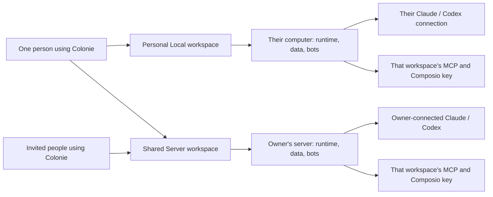
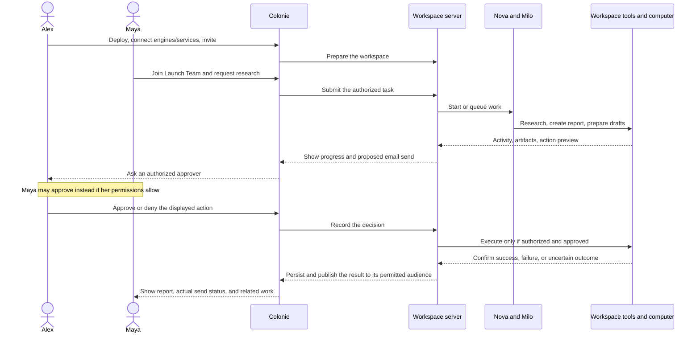
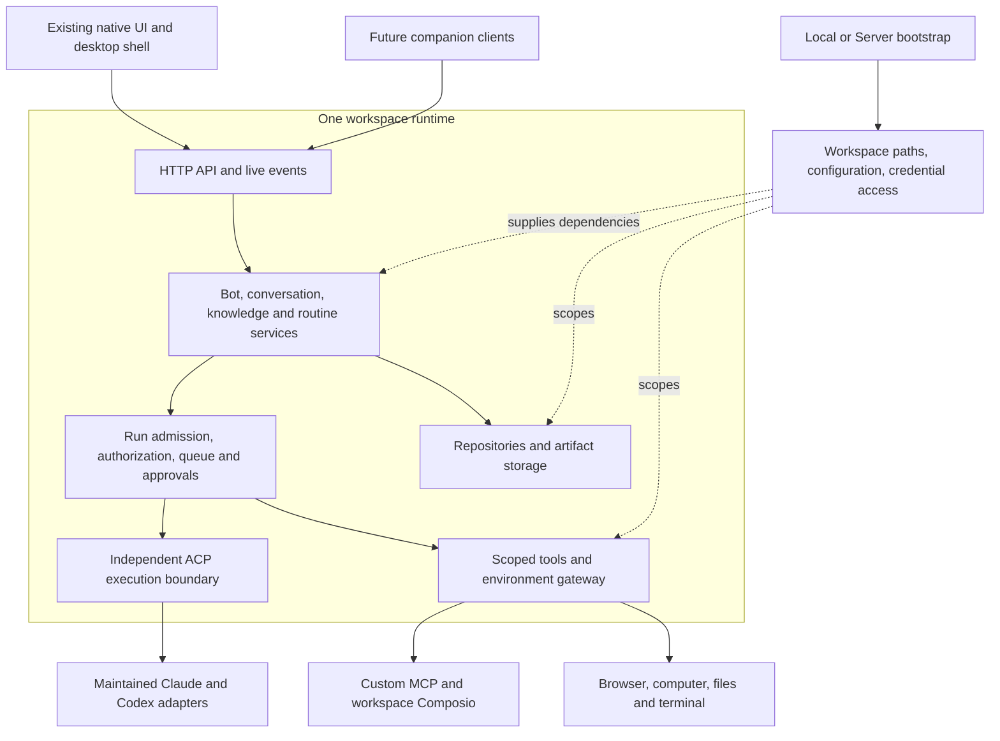
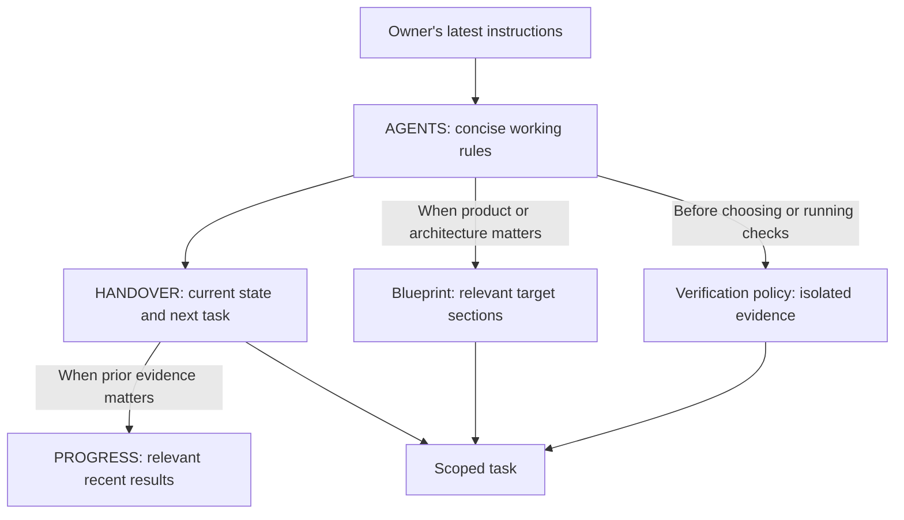

# Colonie product blueprint

## Quick orientation

This is the **single provisional product target**, not today's feature list.
The current implementation is a local macOS ACP app; see [HANDOVER](HANDOVER.md).
The intended product preserves the native UI, bot identities/skills, browser and
computer use, integrations, automation, and human/bot collaboration. Free Local
workspaces and owner-funded Server workspaces are the working direction.

- Every new Local workspace follows the same J01 journey, regardless of membership elsewhere.
- Server workspaces are a future target: owner supplies infrastructure, engine access, and workspace integrations; invitees use that workspace.
- Composio credentials are user-supplied per workspace. Different workspaces can use different keys/accounts.
- Behaviors marked Proposal/Open are not final owner decisions. Research is documentation-based, not a competitor parity certification.
- Read relevant sections only. Validate current code against the target before planning implementation.
- The [architecture audit](#architecture-audit-october-17-2026) identifies the main structural problems and target boundaries. Its first shared-rule extraction is implemented with static/unit evidence; see [recent progress](PROGRESS.md) for current results and limits.

The blueprint owns product, architecture, and roadmap decisions. Current status
lives in HANDOVER; actual recent results belong in PROGRESS. Only current guidance
is kept in the documentation tree.

### Architecture audit in one minute

The main problem is mixed responsibilities and implicit ownership. The server's
22,876-line entry point combines startup, work coordination, and many API/tool
paths. Data and connection configuration largely belong to one process. Some
server helpers still live in UI modules, while retired agent implementations
remain imported for small utility functions.

Keep the existing native UI, maintained ACP execution, HTTP/live events, and useful
storage infrastructure. Recommended order:

1. Move shared message/attachment rules into a neutral shared module.
2. Make each workspace's data, configuration, credential access, and lifetime explicit.
3. Separate work coordination from HTTP and startup wiring.
4. Remove legacy implementation after detaching its useful helpers; split UI state internals while preserving the visible experience.

Start with one runtime per workspace as a proposal, without introducing several
workspaces into today's global process state. The first extraction has removed
the three audited server-to-UI imports, with focused content-compatibility checks.
Read the [diagram, source findings, and retain/adapt/remove map](#architecture-audit-october-17-2026)
for the technical detail. The audit was static; subsequent extraction evidence is
in PROGRESS and does not establish complete runtime or desktop behavior.


Status: working draft for owner review. Last researched: October 16, 2026.

This document brings the intended product, reference research, architecture proposal, business model, and delivery plan into one place. It describes the destination while the repository is being cleaned up. Existing code and old upstream documentation do not define that destination.

Nothing here turns a provisional conversation into an irreversible decision. A documented competitor feature is not evidence that Colonie already implements it. Architecture and delivery recommendations remain proposals until reviewed.

For a short technical orientation, start with the [architecture audit](#architecture-audit-october-17-2026). For product behavior, read [Walkthrough W01](#walkthrough-w01-a-team-completes-real-work). Both describe proposals and evidence limits, not completed implementation.

## Contents

1. [Product direction](#1-product-direction)
2. [Research findings and limits](#2-research-findings-and-limits)
3. [Workspace model and journeys](#3-workspace-model-and-journeys)
4. [Capability inventory](#4-capability-inventory)
5. [Collaboration behavior](#5-collaboration-behavior)
6. [Architecture proposal](#6-architecture-proposal)
7. [Repository and instruction structure](#7-repository-and-instruction-structure)
8. [Commercial model, operating costs, and capacity](#8-commercial-model-operating-costs-and-capacity)
9. [Delivery plan and acceptance](#9-delivery-plan-and-acceptance)
10. [Open decisions and next work](#10-open-decisions-and-next-work)
11. [Source register](#11-source-register)

## 1. Product direction

Colonie is a native place where people and AI teammates gather, communicate, and get work done. Bots have identities, skills, memory, connected services, and access to tools and computers. People can work privately on their own computer or collaborate in a workspace running on infrastructure paid for by its owner.

The owner explicitly wants Grok Bot as the primary product reference. Its existing workflows should provide the starting point for discussion. The goal includes browser use, computer use, automation, collaboration, and companion access; these must remain visible throughout planning. Preserve the native UI the owner already likes.

### Reading the status labels

| Label | Meaning |
|---|---|
| Owner direction | Explicitly expressed by the owner; still revisable. |
| Reference behavior | Supported by a linked external source; not a claim about Colonie. |
| Proposal | A recommendation made during planning; not an owner decision. |
| Open | Requires a specific decision, provider clarification, or practical validation. |

### Owner direction register

| ID | Working direction |
|---|---|
| D01 | The product is named **Colonie** and should become independent of the upstream project and its hosted service. Preserve useful infrastructure and UX based on merit. |
| D02 | Keep the current native desktop experience as the starting point. |
| D03 | Bots have configurable names, personas/SOUL, and skills. |
| D04 | Support Claude Code and Codex through ACP and the maintained adapters, using the user's existing provider subscription where supported. |
| D05 | Provide predefined Composio integrations and user-configured custom MCP connections. |
| D06 | A person can create multiple independent workspaces and choose Local or Server for each. |
| D07 | Local workspaces are free and require no Colonie account. A name/email may be requested for the UI rather than authentication. Required fields remain open. |
| D08 | Creating a new Local workspace includes its own engine onboarding and Claude/Codex connection, even if that person already uses a Server workspace. |
| D09 | A Server workspace runs its agents, ACP adapters, integrations, and working environment on the owner's server. Members use that environment through Colonie. |
| D10 | The owner connects the workspace's Claude/Codex. Invited members can use its bots without connecting their own provider subscription. Provider support for this commercial arrangement still needs validation. |
| D11 | MCP connections belong to the workspace. Personal integrations should live in a person's separate workspace rather than a personal overlay inside a shared workspace. |
| D12 | Composio credentials are also user-supplied and configured per workspace. Different workspaces can use different Composio API keys/accounts; their service costs belong to those accounts. Colonie can supply the integration catalog and setup UI. |
| D13 | Server workspaces support invited humans, bots as members, direct conversations, and project groups containing both. Human messaging is part of the collaboration experience. Local workspaces are personal in the current direction. |
| D14 | The intended Server journey is guided deployment for nontechnical owners, ideally one click after the necessary provider authorization. Infrastructure is paid for by the owner. |
| D15 | The commercial direction is a one-time Colonie purchase per Server workspace. Two separate Server workspaces would require two purchases. Pricing and terms remain provisional. |
| D16 | Members should not need another Colonie purchase to accept an invitation. Local workspace creation remains free. |
| D17 | Show ongoing compute usage so owners can understand when an upgrade is useful. Upgrades should be understandable to nontechnical people. |
| D18 | Grok Bot is the default feature/behavior reference, including computer use, browser use, automation, and companion capabilities. Extend its model where Colonie's human collaboration and workspace ownership require it. |

### Deliberate differences from the reference

These differences are part of the intended product rather than accidental omissions.

| Area | Colonie direction | Reference context |
|---|---|---|
| Product identity and UI | Independent Colonie brand; preserve the native UI the owner likes. | Reuse the interaction ideas, not another product's identity. |
| Execution engine | Owner-supplied Claude Code/Codex through ACP. | Grok Bot manages its own model experience. [Settings](https://cursor.com/docs/grok-bot/settings) |
| Bot profile | Keep editable persona/SOUL and skills. | Current Grok personal-bot settings have changed; names/avatars remain while behavioral instructions can be saved through conversation. Copying its latest screen removal would conflict with D03. [Editing bots](https://cursor.com/help/grok-bot/edit-bot) |
| Ownership and billing | Workspace-owned environment; owner pays infrastructure and connects AI. | Grok TeamBots have per-person chats, plugin overlays, and reader usage accounting. [TeamBots](https://prod.cursor.com/help/grok-bot/team-bots) |
| Integrations | Workspace-scoped MCP and user-supplied Composio key. | Do not copy personal connector overlays into shared workspaces. |
| Local access | Free, no Colonie account required. | Grok Bot's ongoing access depends on an eligible paid plan. [Plans](https://cursor.com/help/grok-bot/plans) |
| Hosting | Owner-funded infrastructure with guided provisioning. | Grok provides a managed cloud computer. [Overview](https://cursor.com/docs/grok-bot) |

## 2. Research findings and limits

### What the reference actually validates

Grok Bot documents persistent bots working with a browser, filesystem, terminal, and a shared computer. It also documents groups, delegation, routines, connected services, voice, mobile access, and recovery. The relevant baseline is a working assistant environment with a messaging interface. [Product overview](https://cursor.com/docs/grok-bot)

Its ongoing product access is paid, but there are trial allowances and eligible subscription bundles. Therefore, “no permanent free Bot tier” is more accurate than “no free access of any kind.” Colonie's one-time purchase plus existing subscriptions is a positioning hypothesis; it is not automatically cheaper for every customer already receiving Grok Bot in a bundle. [Current access and plans](https://cursor.com/help/grok-bot/plans)

Public adoption reports and customer stories are useful demand signals. They do not establish paid conversion, revenue, retention, profitability, or demand specifically for Colonie's owner-hosted model. The reviewed Bloomberg report describes 418,000 weekly users, rather than 418,000 paying customers. [Bloomberg reporting via Bloomberg Technoz](https://www.bloombergtechnoz.com/detail-news/122463/agen-ai-grok-bot-elon-musk-diserbu-400-000-pengguna-dalam-sepekan)

### Research method

This is a documentation review, not a hands-on evaluation of a paid Grok Bot installation. Primary product/help pages are the main evidence; dated staff forum answers fill custom-MCP gaps. Upstream project documentation is a secondary discovery reference for useful capabilities the owner may not have encountered. It does not dictate Colonie's architecture. External source names and URLs retain their real identity; a Colonie branding change must not rename a cited source.

Documentation changes and rollouts can disagree. For example, older template instructions refer to settings that newer bot-editing guidance has removed. Preserve the intended capability, record the source/date, and verify the actual interaction before claiming exact parity. No competitor documentation establishes Colonie's implementation status.

### Three important feasibility boundaries

1. **ACP connects an application to an agent.** Its session setup supports working directories and MCP configuration. It does not supply workspace accounts, invitations, billing, schedules, speech, or a remote desktop. Those are Colonie responsibilities or separate integrations. [ACP session setup](https://agentclientprotocol.com/protocol/v1/session-setup)
2. **Native subscription authentication is different from a shared commercial entitlement.** Headless authentication and adapter availability do not prove that one owner's subscription can support all invited humans under every provider plan. Keep the intended journey, but validate the supported arrangement before selling that promise. [OpenAI authentication](https://learn.chatgpt.com/docs/auth), [Claude plan use with the Agent SDK](https://support.claude.com/en/articles/15036540-use-the-claude-agent-sdk-with-your-claude-plan)
3. **Free Local software does not make external services free.** The user supplies AI access, Composio credentials, and any other paid service needed by the chosen capability. Composio publishes free allowances and paid usage; its limits are separate from Colonie pricing. [Composio pricing](https://composio.dev/pricing)

## 3. Workspace model and journeys

### What a workspace owns

**Owner direction:** the workspace is the boundary for its environment, bots, conversations, integrations, Composio configuration, and provider setup.

**Proposal:** make the workspace the persistent logical unit with a stable ID. A workspace's identity should survive server replacement, backup restoration, and resizing. Whether every Server workspace initially gets its own VM is a provisioning decision, not the definition of a workspace.

| Property | Local workspace | Server workspace |
|---|---|---|
| Runs on | The person's computer | Infrastructure paid for by the owner |
| Colonie access | Free | Proposed one-time purchase per workspace |
| Human collaboration | Personal workspace in the current direction | Owner invites members |
| Profile/account | Local display profile; no Colonie signup | Authenticated membership; account architecture open |
| Claude/Codex | Set up for that workspace | Owner connects on the server; members use workspace bots |
| Composio | User supplies that workspace's key | Owner supplies that workspace's key |
| Custom MCP | Configured for that workspace | Configured for that workspace and reachable from its server |
| Working files and browser | On its selected local environment | On its selected server environment |
| When desktop is closed | Work depends on the local runtime staying available | Server work can continue while client apps are closed |
| Personal email/tools | Connect here for personal work | Shared workspace connections follow workspace access policy |

Local describes where execution and persistence live. Claude/Codex and connected services may still use the internet. It does not mean offline AI.



### Journey J01: create a Local workspace

1. Open Colonie; download and install it first if needed.
2. Choose to create a workspace and select Local.
3. Name the workspace and provide a local display profile if requested.
4. Connect Claude Code and/or Codex using the supported native authentication flow.
5. Create or choose a bot; configure its identity, persona, and skills.
6. Start work. Add Composio or custom MCP only when needed; these are not prerequisites for a basic chat.

No Colonie account or payment is required. Secrets should use protected setup fields or provider-owned authentication, rather than chat messages.

Every new Local workspace follows this same journey, whether it is the person's first workspace or they already own or belong to other workspaces. Membership elsewhere does not create a different onboarding flow. Configure the new workspace's own engine access and any integrations it needs; another workspace's credentials and history are not automatically imported. Personal automation is one possible use of a Local workspace, not a separate workspace type or journey.

### Journey J02: owner creates a Server workspace

1. Download Colonie and choose Create workspace → Server.
2. See what the Colonie purchase covers and which recurring services the owner pays separately.
3. Authorize an infrastructure account or use a supported connection to an existing server. Select an understandable starting configuration.
4. Start guided deployment. Show progress, retryable failures, and how to remove an incomplete deployment without guessing which resources were created.
5. Connect Claude Code/Codex on the server using a supported headless authentication journey.
6. Add the workspace's Composio key and/or custom MCP as needed.
7. Create bots, invite people, and create project groups.

“One click” describes the provisioning step after required authorization. Provider signup, billing authorization, AI sign-in, and a service's consent screen cannot be assumed to disappear. The exact purchase/setup order remains a UX proposal.

### Journey J03: member accepts an invitation

1. Open the invite and authenticate as the intended person.
2. Install/open Colonie and arrive in the invited workspace.
3. See the bots and conversations available to that membership.
4. Use existing bots and workspace connections immediately, without buying Colonie or connecting a personal AI subscription.

Deep-link handling, expired invitations, revocation, and an already-installed app must be covered. The member is joining an existing environment, not provisioning another server.

### Journey J05: switch, resume, and recover

The workspace switcher makes the active workspace and execution location clear. Returning to a workspace restores its conversations and actual work status. If its runtime is offline, the UI says so rather than suggesting an agent is working. Recovery distinguishes restarting a process, restoring a backup, and rebuilding a computer.

**Open:** whether Local ↔ Server migration is offered initially, which data migrates, and which authorizations must be repeated. Do not silently equate migration with creating an unrelated workspace or transferring every secret.

### Walkthrough W01: a team completes real work

**Status: proposed Colonie behavior for review.** This is a fictional product walkthrough, not a transcript, a statement of implemented behavior, or a claim about Grok's undocumented internals. It applies the owner's Local/Server and integration directions to a concrete task. The examples of services and tools do not select a hosting vendor or promise a particular provider capability.

**The story in five steps:** an owner prepares a Server workspace; an invited member requests work in a project group; bots use that workspace's services and computer; an authorized person reviews an outgoing action; the group receives the result and can inspect what happened.

#### People, bots, and the workspace

| Participant or resource | Role in this example |
|---|---|
| Alex | Workspace owner. Pays for the server, connects Claude/Codex, supplies this workspace's Composio key, and authorizes shared service accounts. |
| Maya | Invited teammate. Uses Colonie without supplying an AI subscription, provisioning a server, or purchasing another workspace. |
| Nova | Research bot with a saved name, persona, and research skill. |
| Milo | Operations bot with a saved writing procedure and document/email skills. |
| Launch group | A project conversation containing Alex, Maya, Nova, and Milo. It supports human messages whether or not a bot is invoked. |
| Workspace environment | Server-side files, browser, and supported desktop tools. Its credentials and work stay within this workspace's configured access boundaries. |
| Workspace connections | The shared CRM and email account authorized for this project, using the workspace's own Composio configuration or custom MCP. These are not Maya's personal accounts. |

#### From installation to a finished task

| Step | What the person does or sees | Expected Colonie behavior in this proposal |
|---|---|---|
| W01.01: create | Alex opens Colonie, selects Create workspace → Server, and names it Launch Team. | Explain the one-time Colonie purchase separately from recurring infrastructure, AI, and optional service costs. Show the active workspace clearly. |
| W01.02: deploy | Alex authorizes the supported infrastructure account, reviews the starting configuration and estimated provider bill, then selects Deploy. | Provision into the owner's account, show progress and recoverable errors, and record which resources belong to this deployment. No bots are advertised as ready before the runtime is available. |
| W01.03: connect | Alex follows supported Claude/Codex sign-in, supplies this workspace's Composio key, and connects the shared CRM/email services. | Keep secrets out of chat. Show each engine/service's actual readiness. A Composio API key and a connected Gmail/CRM account are separate setup steps; one does not prove the other is authorized. [Composio connection model](https://docs.composio.dev/reference/api-reference/connected-accounts) |
| W01.04: prepare | Alex configures Nova and Milo using their ordinary bot profiles, creates Launch, and invites Maya. | Saved persona/skills are sufficient for normal use. No ACP inspector setup is required. The invitation identifies Launch Team and its inviter. |
| W01.05: join | Maya accepts, opens/downloads Colonie, authenticates as required, and enters Launch Team. | Use the existing workspace, bots, and connections. Do not request Maya's Claude/Codex login or personal Composio key. Show only conversations and capabilities her membership can access. |
| W01.06: request | Maya posts the task below to Nova in Launch. | Persist the message and show that Nova has accepted or queued the work. Targeting Nova explicitly keeps this example independent of the unresolved policy for unmentioned bots. |
| W01.07: investigate | Maya sees Nova researching, with readable tool activity and results as they become available. | Use authorized CRM tools and the workspace browser. Choose suitable tools for the task rather than forcing desktop clicks when an API or browser action is enough. Do not include unrelated private chats or another workspace's data. |
| W01.08: collaborate | Nova asks Milo to prepare the outreach drafts using the research. | Make the handoff visible from the original task, with a link to the delegated work and its status. Share only the context Milo is authorized to receive. Nova is responsible for assembling this particular requested result; this is not a rule making one bot the permanent coordinator of every group. |
| W01.09: produce | The bots create the report and draft messages. If the task needs a supported desktop editor, Maya can inspect its screen. | Save artifacts in the workspace and provide stable links/previews. Browser/computer viewing and authorized takeover operate on the workspace environment, not Maya's personal desktop. Keep use of a shared screen coordinated. |
| W01.10: review | Colonie presents the exact outgoing drafts, recipients, and proposed send action to an authorized human. | Wait before sending. Maya can approve only if her workspace permissions allow this action; otherwise route it to Alex or another authorized approver and explain whom it is waiting for. Engine-level prompts remain additional requirements where applicable. |
| W01.11: finish | After approval, the permitted send is attempted and Launch receives the report, draft/sent status, and a concise result. | Report actual tool confirmation, failure, or uncertainty. Preparing a draft is not the same as sending it. Provide the related bot work without disclosing a conversation the viewer cannot access. |
| W01.12: revisit | Maya closes Colonie and later returns, or opens a supported companion client. | Restore persisted work and actual server status. Other authorized server work may continue while clients are closed. Companion functionality depends on the supported device and its permissions; invitation links and pairing credentials serve different purposes. |

The example request, shown as user-authored content:

> @Nova Research these three companies using their public websites and our shared CRM. Save a short report and ask Milo to draft two outreach emails. Show us the drafts and wait for approval before sending anything.

The task uses a website, connected services, files, and delegation naturally. Computer use remains available for app work that actually needs it. A separate demonstration must exercise a real desktop action and takeover before computer-use support is claimed.



#### Approval, steering, and interruption

**Proposed defaults for this walkthrough:** a pending send waits for an authorized decision; approving one displayed action does not grant permanent access to all email actions. If the draft, recipient, or material action details change after review, obtain approval for the changed action. The exact permission model, reusable grants, and expiry settings remain Q02/Q03 decisions.

Maya can steer Nova while it works. A follow-up such as “Use a more casual tone” should be acknowledged and associated with the active work. It should not silently create a second independent email send. If the send already happened, say so and treat any corrective action as new work.

**Recommended Stop behavior:** offer Stop for the selected task and its delegated work. Stop admitting further actions, request cancellation of its active agent/tool work, and show Stopping until known work has settled. Distinguish a child that stopped, finished before cancellation, or has an unresolved external action. Other unrelated workspace tasks and future routine schedules keep their own controls. This is a proposal, not a documented Grok cancellation guarantee; adapter/tool support must be validated.

#### What happens when something goes wrong

| Situation | Proposed visible behavior | Design question or evidence needed |
|---|---|---|
| Deployment fails halfway | Keep the workspace in Setup incomplete. Offer a retry or reviewed cleanup of the resources created by that attempt. | Verify provisioning retries do not create duplicate paid servers. |
| An invite expires or access is revoked | Explain that access is unavailable and provide a way to contact the inviter. Do not start fresh engine onboarding for the shared workspace. | Define invitation identity, expiration, and revocation rules under Q05. |
| The CRM connection expires | Show which connection needs attention, who may reconnect it, and which work can still proceed. | Do not treat a working Composio key as proof the underlying service token is valid. |
| A website needs login or human interaction | Ask an authorized person to take over the workspace browser; show which task is waiting. | Validate real browser takeover, supported authentication, and resumption. No password-in-chat fallback. |
| Another bot uses the same screen | Queue conflicting interactive work and explain the wait. Allow independent work only within verified resource/isolation limits. | Choose and test shared-screen/browser coordination under Q06. |
| Nobody can approve right now | Keep the action waiting or expire it according to the selected policy; notify the authorized audience. | Absence of an approver does not count as approval. Choose unattended-routine behavior. |
| AI quota or authentication blocks work | Show the provider-specific problem and the next available action. | Do not recommend a bigger VM as a remedy for an AI account limit. |
| CPU/RAM is busy | Show queued work and sustained pressure, using measured limits. | Select limits after benchmarking; do not auto-purchase a larger server. |
| The app loses its connection | Show connection loss and the last confirmed status. Reconnect to persisted task events. | A disconnected client alone does not mean the server task failed or stopped. |
| The server restarts | Recover task status and any durable approval state; reconcile incomplete operations before deciding whether a retry is safe. | Never blindly repeat a potentially completed email send because its final acknowledgment was lost. |
| A send result is uncertain | Show that confirmation is pending/unknown, preserve the evidence, and reconcile with the service where possible. | Do not label an uncertain external side effect Failed and automatically resend it. |
| Maya is removed mid-task | Reject new requests from Maya and re-evaluate her pending approvals and work authority. Preserve the task record for its permitted audience. | Choose cancel/continue/transfer rules explicitly; do not inherit the owner's authority automatically. |

#### Extending the same story

**A scheduled version:** Maya asks for this research every Monday at 9:00 AM in the workspace's displayed timezone. Show the exact task, destination, timezone, responsible identity/bot, required connections, and approval behavior before saving. A routine creates a separate recorded run each time. Test now performs real work and must be labeled accordingly. A schedule is not an instruction to send email without the configured approval policy. Pause schedule and Stop current run are separate controls.

**An event-triggered version:** an authorized CRM event or webhook creates a recorded run. Show the incoming event, deduplicate retries as designed, and separate event acceptance from task completion. Define behavior when many events arrive, the runtime is offline, or its queue is full.

**Personal-work example (the same J01 journey):** Maya creates a Local workspace by following J01, just like anyone else. She can then connect her personal email and create automation there. The work runs on her selected local environment. Launch Team's credentials, bots, and private history are not silently copied. When the local runtime is asleep or stopped, explain which work cannot proceed and apply the selected missed-schedule policy after recovery.

**A companion version:** an authorized device can inspect work and answer the decisions supported by that client. Closing the phone app, losing its network, and stopping the workspace runtime are different states. Voice/dictation and mobile notifications need their own verified services/device behavior; they are not assumed to appear simply because chat works.

#### Decisions this walkthrough recommends, without finalizing them

| ID | Recommended starting behavior | Still open |
|---|---|---|
| B01 | Explicitly mention the intended bot for a directed request; human chat remains useful on its own. | Automatic/unmentioned participation and arbitration between multiple bots. |
| B02 | Link delegated work to the originating task and publish an authorized summary/result back to its requesting audience. | Private handoffs, audience changes, and cross-group delegation. |
| B03 | Resolve approval through an eligible human with the relevant capability; workspace engine ownership does not grant every member every tool action. | Roles, reusable permission grants, and unattended escalation/expiry. |
| B04 | Scope Stop to the selected task and its descendants, with honest cancellation progress. | Exact adapter/tool cancellation semantics and behavior of already-running external actions. |
| B05 | Coordinate conflicting screen/browser work and bound concurrency rather than racing input. | Per-bot environment isolation and measured numeric limits. |
| B06 | Keep runtime/task history and service confirmation sufficiently distinct to recover uncertain side effects. | Supported provider reconciliation and retry guarantees. |
| B07 | Keep server jobs independent of client availability; keep Local availability explicit. | Missed-run/catch-up policy, notification delivery, and supported companion operations. |

These proposals address Q02, Q03, Q06, and Q09; they do not mark those decisions resolved. Owner subscription support (Q01), hosting selection (Q04), and account architecture (Q05) remain independent feasibility/design work.

#### Evidence to collect before implementation claims

Use the existing acceptance IDs rather than inventing a competing test plan: A03/A04 for profile and computer interaction, A05–A08 for server setup/invitation/integrations/groups, A09–A11 for automation/interruption/availability, and A12–A14 for recovery/capacity/companion.

First inspect supported provider/adapter contracts and existing code read-only. Then define a small disposable proof with a fixed task boundary, no real outgoing email, one heavy verification process at a time, and a clearly stated request/resource budget. Fake providers can demonstrate orchestration and UI states; a bounded real-provider check and actual tool/device evidence are separate milestones. The complete fictional story is not a reason to launch a full suite, provision a server, or send messages now.

## 4. Capability inventory

This is a target coverage map, not a release checklist claiming everything is implemented. **Core** means central to the intended product. **Catalog** means a discovered capability retained for an explicit scope decision. A later phase is sequencing, not automatic rejection.

| ID | Capability | Colonie target and reference evidence | Scope |
|---|---|---|---|
| F01 | Native desktop home | Preserve the liked native experience, workspace switcher, accessible appearance, keyboard navigation, and clear work status. Reference preferences and update surfaces are documented in [Grok settings](https://cursor.com/docs/grok-bot/settings). | Core |
| F02 | Bot identity and persona | Name, avatar, role/persona/SOUL, skills, and understandable configuration. Preserve owner direction even where current Grok personal settings differ. [Bot editing](https://cursor.com/help/grok-bot/edit-bot) | Core |
| F03 | Persistent bot memory | Bots retain useful context; people can understand and correct saved knowledge. Keep workspace-shared knowledge distinct from conversation access. Editable memory is also listed by the upstream project documentation. | Core |
| F04 | Conversations and work history | Persistent chats/tasks, live responses, tool activity, attachments, and readable results. [Working with Grok Bot](https://prod.cursor.com/docs/grok-bot/work) | Core |
| F05 | Conversation controls | Search, replies, reactions, pins, organization, unread/attention state, and hide/restore. Reference organization is described in [How-to guidance](https://cursor.com/help/grok-bot/how-to). | Core |
| F06 | Editing and portability | Edit/branch/rewind, export/share content, and multiple tasks per bot are useful discovery items. Provider session semantics must be respected. the upstream feature map | Catalog |
| F07 | Human and bot groups | Project conversations containing humans and bots, targeted mentions, and observable bot participation. Human membership is a Colonie extension of the [Grok group baseline](https://prod.cursor.com/help/grok-bot/group-chats). | Core |
| F08 | Bot delegation | Bots can request help and pass work to another bot. Preserve visibility of who is working and where a result appears. Grok handoffs can appear in separate chats. [Group behavior](https://prod.cursor.com/help/grok-bot/group-chats) | Core |
| F09 | Steering and interruption | People can follow activity, send steering messages, and stop work. Completed side effects are not undone by Stop. Exact cancellation of delegated work needs a Colonie contract. [Work controls](https://prod.cursor.com/docs/grok-bot/work) | Core |
| F10 | Questions and approvals | Clear pending questions/actions, decision ownership, expiry/recovery behavior, and attention notifications. [Grok how-to](https://cursor.com/help/grok-bot/how-to), [Security](https://prod.cursor.com/docs/grok-bot/security) | Core |
| F11 | Browser use | Bots navigate sites and perform browser work; users can inspect and take over for login or difficult steps. A browser is a runtime capability, not something ACP automatically creates. [Grok computer overview](https://cursor.com/docs/grok-bot) | Core |
| F12 | Computer use | Desktop observation/control, screenshots, app interaction, and human takeover in a defined environment. Shared desktop contention and host permissions require explicit handling. [Grok overview](https://cursor.com/docs/grok-bot) | Core |
| F13 | Files and terminal | Work with documents/files, execute supported commands, produce artifacts, and preserve working state. Downloads and task outputs need a clear home. [Grok overview](https://cursor.com/docs/grok-bot) | Core |
| F14 | Skills and teaching | Reusable procedures; capture a demonstrated workflow, review it, and test it before recurring use. [Working and learning](https://prod.cursor.com/docs/grok-bot/work) | Core |
| F15 | Predefined integrations | A simple service catalog backed by the workspace's user-supplied Composio key, with connect/reconnect/disconnect and account labels. Reference plugin lifecycle: [Connect plugins](https://prod.cursor.com/help/grok-bot/connect-plugins). | Core |
| F16 | Custom MCP | Add user-selected servers and inspect connection/tool availability. Local commands and remote endpoints have different deployment needs. Dated staff confirmation: [Custom MCP](https://forum.cursor.com/t/grokbot-custom-connectors/169965/5), [Sharing custom MCP](https://forum.cursor.com/t/how-do-i-share-a-custom-mcp-that-one-of-my-bots-has-built-with-the-rest-of-my-team/173538). | Core |
| F17 | Credentials and service login | Protected secret entry, reconnection, replacement, and browser takeover. Do not ask people to paste passwords into conversations. [Grok secrets](https://cursor.com/help/grok-bot/secrets) | Core |
| F18 | Scheduled routines | Create, inspect, pause/resume, test, and remove recurring or one-time work; show timezone and results. [Routines](https://prod.cursor.com/help/grok-bot/routines) | Core |
| F19 | Event automation | Connected-service events and authenticated webhooks trigger work; show accepted, queued, running, and completed states separately. [Routines and webhooks](https://prod.cursor.com/help/grok-bot/routines) | Core |
| F20 | Background work | Server jobs continue when client apps close. Local jobs depend on the local host remaining available. [Grok work model](https://prod.cursor.com/docs/grok-bot/work), the upstream companion limits | Core |
| F21 | Notifications | Distinguish work in progress, unread results, and work needing action. Desktop/mobile delivery differs and requires its own implementation. [Settings](https://cursor.com/docs/grok-bot/settings), [Mobile](https://cursor.com/help/grok-bot/mobile) | Core |
| F22 | Dictation and spoken replies | Voice input and speech output are separate capabilities from live calling; service choice and funding remain open. [Grok voice](https://prod.cursor.com/help/grok-bot/voice-chat) | Core target; rollout open |
| F23 | Live bot voice conversation | A real-time conversation with a bot, including transcript and mute/end controls. Grok documents one-to-one calls, with group/TeamBot limitations. Do not promise group calls as existing parity. [Voice chat](https://prod.cursor.com/help/grok-bot/voice-chat) | Core target; rollout open |
| F24 | Companion/mobile access | View chats, steer work, answer questions/approvals, and inspect supported computer activity from another device. Choose supported platforms explicitly. [Grok mobile](https://cursor.com/help/grok-bot/mobile), the upstream companion | Core target; rollout open |
| F25 | Bot templates and reusable teams | Preview and install reusable instructions/skills/knowledge/routines. Recipes must identify required connections without exporting credentials. [Grok templates](https://x.ai/bot/guides/templates-for-grok-bot) | Catalog |
| F26 | Bot email identity | An address a bot can receive/send through is a useful discovery item. Grok distinguishes agent email from connected personal Gmail and gates outgoing sends. Hosting, ownership, and approval model remain open for Colonie. [Agent email](https://prod.cursor.com/help/grok-bot/agent-email) | Catalog |
| F27 | Recovery and environment maintenance | Understandable restart/rebuild distinctions, backups, restore, disk pressure, and lost-login recovery. [Computer recovery](https://prod.cursor.com/help/grok-bot/computer-recovery) | Core |
| F28 | Resource and usage visibility | Show runtime health, CPU/RAM/disk, queue pressure, and available provider usage information. Do not invent precise subscription balances when a provider does not expose them. Infrastructure metrics: [Monitoring](https://docs.digitalocean.com/products/monitoring/). | Core |
| F29 | USB phone control | A bot operating a physically connected Android phone is different from a phone being a Colonie client. Keep this discovered capability visible for a later decision. the upstream Android control notes | Catalog |
| F30 | Server administration | Invitations, revocation, role/access settings, deployment status, upgrades, backups, and ownership recovery. Colonie's workspace model requires these beyond a personal bot app. | Core extension |
| F31 | Workspace knowledge and access | Explicit shared vs conversation-scoped knowledge and access policy. Grok TeamBots distinguish team/personal knowledge, but their per-user computing/billing model is not Colonie's. [TeamBots](https://prod.cursor.com/help/grok-bot/team-bots) | Core extension |
| F32 | Usage controls and accountability | Attribute work to initiating people/routines/bots; expose run history and apply understandable concurrency/budget controls. Exact policy is a proposal to validate rather than presumed Grok internals. | Core extension |
| F33 | Diagnostic inspector | Optional developer view of app-authored input, provider events, and failure evidence. Default UX remains simple. Native agent/project instructions remain provider-owned. | Existing fork direction |
| F34 | Enterprise governance | SSO, organization policies, advanced audit/recording, and provisioning are reference capabilities, not automatically first-release requirements. [Grok teams](https://cursor.com/docs/grok-bot/teams) | Catalog |
| F35 | Human messaging | Human-to-human direct conversations and human group chat within a Server workspace, with bots participating where relevant. A conversation does not require an AI response to be useful. | Core extension |

“Catalog” is not a decision to remove a feature. Each item needs a documented include/defer/drop decision before claiming a complete product scope. No source review establishes an exhaustive inventory of every private preview, integration, or enterprise feature.

## 5. Collaboration behavior

### Documented reference behavior

Grok groups support direct mentions. Bots may also message other bots or the person privately, and delegated work can appear in another bot's chat. Instructions can influence where replies go. Its help page does not establish an invariant that every delegated result stays in the initiating group, a dedicated universal bot-to-bot disable switch, or a fixed single-responder policy. [Group chats](https://prod.cursor.com/help/grok-bot/group-chats)

Grok TeamBots introduce shared bots with per-person conversations, owner-maintained shared knowledge, and optional personal connections. Their usage attribution and computing rules differ from the owner-funded shared environment requested for Colonie. Those are reference observations rather than a ready-made Colonie access policy. [TeamBots](https://prod.cursor.com/help/grok-bot/team-bots)

### Colonie's required extension

Human membership makes audience and authority first-class product concerns. A bot must not treat the workspace's complete history as context simply because it shares an engine connection. Workspace-owned MCP means connection ownership; it does not yet answer whether every member can perform every action with it.

**Proposed minimum behavior to review:**

- Show the initiating conversation, active bot, delegated work, and result destination clearly.
- Track which human or routine initiated each run, including child runs.
- Make approval ownership explicit so an unattended or ambiguous group cannot silently bypass a required decision.
- Provide visible bounded execution, cancellation status, and a recovery path when a tool cannot be interrupted.
- Enforce conversation/tool access on the server before assembling context or dispatching a run.
- Treat bot persona, saved memory, skill instructions, retrieved content, and native project instructions as distinct sources with inspectable provenance.

These are design recommendations, not claims that Grok uses an identical mechanism.

**Still open:** when an unmentioned bot responds; how multiple bots coordinate; delegation depth and budgets; what Stop cancels; who can approve a shared action; which DMs are private from other members; what owners can administer; what happens when an initiating member is revoked mid-run.

An owner controlling the actual server can potentially access its stored data. UI-level private conversations must not be marketed as cryptographically private from that server operator without a separately designed and verified system. This matters especially if bots can search shared files or memories.

## 6. Architecture proposal

This section proposes boundaries for the target. It is not an instruction to reorganize the current repository immediately.

### Architecture audit: October 17, 2026

**Finding:** Colonie has useful reusable foundations, but responsibilities remain concentrated in the server entry point and shared process state. Start by enforcing dependency and workspace boundaries, then split orchestration and retire legacy paths. Preserve the native UI and existing storage formats throughout this sequence.

**Evidence:** read-only TypeScript AST scan of 936 non-test source/tooling files under `src`, `server`, `shared`, `electron`, and `scripts`, with selected source tracing; checkout HEAD `aa38ecc9` plus existing WIP. The scan resolves relative and configured `@/` imports, excluding type-only edges. It does not execute modules or resolve every computed import, spawned executable, external dependency, or generated asset. No runtime, performance, or security certification follows from these observations.

| Structural problem | Current evidence and consequence | Recommended treatment |
|---|---|---|
| Oversized composition/orchestration hub | [Server entry point](../server/index.ts): 22,876 physical lines, 255 import declarations/literal import calls, and 234 direct first-party value dependencies in the scan. It initializes data/config, wires services, admits work, assembles tools, and handles many routes. Changes cross unrelated responsibilities. | **Adapt:** retain a small bootstrap/composition root; extract application services and HTTP adapters with explicit dependencies. Existing [route factories](../server/routes/README.md) provide a useful pattern. |
| Workspace ownership is implicit in the process | [Config](../server/config.ts) computes `DATA_DIR` from process environment; 52 non-test/tooling modules import it as a value dependency. [Message storage](../server/message-db.ts) owns module-level database/search handles. [Connection sessions](../server/colonie/connections/manager.ts) and [ACP receipts](../server/acp/receipts.ts) also reach for the global directory. | **Adapt:** make paths, configuration, credential access, and lifetime explicit at workspace bootstrap. This is consistent with today's single workspace; it does not yet implement independent future workspaces. |
| Backend depends on renderer implementation | Three direct value-import declarations go from server code into `src/lib`: `escapeAttribute`/`splitTranscriptAttachments` from composer helpers, and `threadRefUrl` from thread helpers. [Backup logic](../server/workspace-backup.ts) consequently shares a module containing uploads, previews, and focus behavior. | **Extract first:** put the genuinely shared content-format rules in `shared`; keep browser/DOM behavior in `src`. This removes a concrete dependency inversion without redesigning the UI. |
| Retired drivers remain helper dependencies | Only [the two ACP providers](../server/drivers/builtIn.ts) are registered, but the server imports `autoCompactWindow` from the 2,707-line [legacy Claude driver](../server/drivers/claude.ts); account/usage code imports its helpers too. That module imports version helpers from the 2,355-line legacy ACP core. | **Retire in order:** lift still-used helpers into small neutral/provider-support modules, update their consumers, then check imports, proxy paths, packaging, and checks before deleting retired implementation. |
| Feature surfaces and execution are disconnected | The maintained ACP branch rejects automation/coordination admission and returns before later inherited browser/computer assembly. Session setup reads `acpTools.servers`, while an extra workspace/skills mount is tracked separately. | **Adapt and verify:** define one authorized run-admission/tool-delivery contract. Test the mount payload discrepancy separately. Do not enable routines/groups by deleting guards or reviving inherited prompt assembly. |
| UI state and transport share one large hub | [Renderer store](../src/state/store.tsx): 4,091 lines and 136 first-party value importers. It combines state folding, commands, SSE handling, notifications, and other effects. Two small UI dependency cycles also appear, including lazy-screen imports. | **Retain UI; adapt internals:** extract a workspace API/event client, feature reducers, and effects behind existing hooks. Cycles are candidates for helper separation, not proof of runtime failure. |
| Cleanup crosses dynamic/runtime boundaries | Removed `remoteClient` bridge reads remain in renderer code; obsolete verification scripts reference retired providers. Process entry paths live in [the proxy manifest](../server/proxy-paths.ts) and [the bundler](../scripts/bundle-server.mjs), outside a simple import graph. | **Remove after dependency checks:** stale remote-only branches/checks; **decide separately:** gated people/sign-in/domain/operator code. Source reachability alone cannot prove a subprocess entry or auth helper is unused. |

No large backend value-import cycle appeared in this scan. The stronger observed coupling is through global ownership, callbacks, and the entry-point hub. A high import count or long file alone is not a defect; the mixed responsibilities and concrete backward dependencies are the reasons to restructure.

### Target responsibility boundaries

**Proposal:** begin with one workspace runtime per process. A desktop can later select the appropriate runtime; a Server workspace runs its runtime on owner-funded infrastructure. This avoids requiring multiple independent workspaces to share today's global database/config state inside one process. It does not require one physical VM per workspace or start multiple processes now.

At bootstrap, supply the workspace identity, data/artifact paths, provider configuration homes, credential-access interface, and lifecycle ownership. Application services receive the dependencies they need. Storage implementations preserve existing SQLite/JSON/file formats initially. Local display identity and future Server membership policy remain distinct.

The dependency direction is: clients → HTTP/events → application services → execution, tool, and repository interfaces. Bootstrap supplies the concrete implementations. Shared contracts/content rules must not import UI, server startup, Electron, or provider implementation. Server code may use portable platform helpers currently located under `electron`; isolate those helpers before treating directory names as proof of an Electron-runtime dependency.

### One workspace runtime, different places to run it

Use the same workspace application core locally and on a server. Native clients display its state and request actions. The workspace runtime owns authoritative membership checks, persistence, run coordination, scheduling, integrations, and execution. Local mode can omit remote-account onboarding without creating a separate product implementation.



The diagram shows responsibility, not a requirement to turn every box into a separate service. Prefer a modular workspace service with clear internal boundaries first. Remote database adoption and microservice splits need evidence rather than being prerequisites for invitations or cloud execution.

### Retain, adapt, remove and implementation order

**Retain:** native UI/interactions, HTTP/SSE contracts, maintained ACP boundary, scoped profile/receipt behavior, atomic writes, SQLite transcripts, and useful JSON/file persistence. Source presence does not establish workflow correctness.

**Adapt:** workspace bootstrap/credential ownership; server application/run orchestration; connections, knowledge and environment interfaces; renderer state/transport internals. Reuse the scoped `server/colonie/` modules where their responsibilities fit.

**Remove after checks:** retired driver bodies after helper extraction; stale remote-client branches; unsupported-provider verification scripts after reviewing their callers. Gated hosted/team capabilities need an explicit decision and dependency review. Preserve useful auth, migration, packaging, and third-party attribution work; none is deleted by this audit.

### Engineering roadmap: architecture and consistency

Owner direction: architecture, folder/file organization, and code/design consistency
must improve deliberately as features develop. This is the engineering track for
product stage P1 and later feature delivery. Its queue is defined here; HANDOVER
selects one active task. Exact module APIs and extraction scopes require current
source inspection. M0 shared-content work has static/unit evidence; the following
stages remain planned, not implemented or verified by writing this roadmap.

| Stage | Change and first bounded task | Dependencies and evidence required to finish |
|---|---|---|
| E01: establish enforceable architecture checks | Inventory current guards, CI selection, and supported checks. Start with the existing content-boundary guard and index-route ratchet; record inherited failures separately. | First engineering stage; keep incomplete M0 evidence explicit. A bad dependency is rejected and a valid change accepted. Required guards cannot silently disappear through CI selection. Verify actual remote merge requirements/bypass settings before claiming merge enforcement; configuration files alone are insufficient. No workflow/settings changes follow from this planning task. |
| E02: explicit workspace ownership | Put workspace paths, configuration, credential references, repository construction, and shutdown ownership at bootstrap. First migrate one existing store/connection boundary that currently reads global config; inspect `server/config.ts` and `server/message-db.ts`. | Needs E01's local baseline, not an unrelated suite rewrite. Test two disposable scopes for the migrated boundary, restart/close behavior, and the existing Local path (A01/A02/A07 where applicable). Finish only when runtime-owned resources follow this ownership; a single injected path proves only that slice. Future Server support remains separate. |
| E03: separate HTTP, application work, and ACP | Extract one supported send/Stop path from `server/index.ts` into a feature service with explicit dependencies; route adapters validate/authorize/translate. Keep provider sessions in `server/acp/`. | E02 ownership must be sufficient for the chosen path. Show send, events, saved input/receipts, approval/cancellation behavior in bounded fixtures (A03/A10); add provider evidence if provider semantics change. Remove the old implementation after moving callers. The entry point composes services and starts/stops them rather than retaining the extracted business logic. |
| E04: finish legacy removal safely | Lift a still-used legacy helper, migrate consumers, then retire the obsolete implementation. Start from the remaining `autoCompactWindow` import; reconcile concurrent cleanup before choosing work. | Dependency checks cover imports, subprocess manifests, packaging, persisted formats, and relevant verification scripts. Prove the maintained path still works. Every removal has a reason; removing a retired implementation does not drop a planned product capability. Do not delete valid workflow coverage to obtain green checks. |
| E05: organize renderer work by feature | Separate API/SSE transport, feature state transitions, and effects behind current hooks. Start with one feature slice in `src/state/store.tsx`; migrate its callers without a broad UI move. | Depends on stable contracts for that slice. Verify event folding, reconnect/selection behavior, and affected UI interactions. The extracted state/effects actually leave the hub, duplicated implementations disappear, and feature modules have clear owners with no new dependency cycles. |
| E06: consolidate code and native UI patterns | Apply the consistency rules below to an existing repeated flow first. Reuse maintained controls and skin tokens; consolidate real duplication while preserving the owner's native UI. | Follow E05 for state changes; begin safe local improvements earlier where independent. Demonstrate compatibility on the affected skin/layout/keyboard flow, relevant token/contrast checks, and no new parallel implementation of the same control or protocol. Review usability and maintenance explicitly; automated checks alone do not settle these judgments. |

Split each stage into independently verifiable tasks in HANDOVER as work reaches
it; do not pre-generate dozens of task documents. A stage is not complete merely
because files moved or wrappers were added. Record which responsibility left its
old owner, where callers now go, which duplicate/legacy path was removed, and the
behavior evidence. File size/import counts support the review but are not quality
scores. Unrelated failures remain explicit; they do not justify weakening checks.
Remote enforcement gaps remain open even if local refactoring can safely proceed.

#### E01 baseline and next proof

October 17 source inspection completed E01.1's inventory. E01.2 then named both
architecture guards in the static CI job's "Enforce architecture boundaries" step,
protected that step with a workflow contract check, and proved accept/reject cases
in disposable copies (local evidence only; see PROGRESS). E01 remains open until
remote merge requirements are inspected. Reuse existing checks before adding tools.

| Existing check | Coverage and gap found in source | Positive/negative proof to run in E01 |
|---|---|---|
| `scripts/testing/content-boundaries.test.ts` | Two server consumers and two shared content modules; direct static imports/re-exports only. Runs in the static CI step (E01.2). | Proven locally: a shared import passes; renderer-from-server and server-from-shared imports fail. Keep computed/transitive coverage limits explicit. |
| `scripts/testing/index-route-ratchet.test.ts` | Limits known path-guard spellings in `server/index.ts`; its own counts are editable and alternate syntax can evade it. Runs in the static CI step (E01.2). | Inherited stale counts (150/82, real 143/80 since the pairing removal) were lowered; a disposable added route guard fails. Lower counts after extraction; do not raise them to excuse new hub logic. |
| Type/lint and UI checks | CI invokes type/lint. `src/lib/skins.test.ts` checks registered skins/tokens in the general suite. `check:contrast` exists but is not invoked by this CI workflow. These do not establish broad architecture or visual quality. | Deliberate type/token violations fail the relevant focused check; valid examples pass. Palette changes need their contrast check and affected visual/interaction evidence. |
| `scripts/ci-scope.mjs`, `scripts/ci-workflow.test.ts`, CI gate | Source selection keeps non-document changes in runtime checks; aggregation rejects unexpected job results. The static job always runs regardless of selection; a contract test now fails if either guard leaves its step or the step becomes skippable. | Removing the step, dropping one guard, or adding `if:` failed in disposable copies. Check source/guard changes select required checks and failed/missing outcomes cannot yield a successful aggregate; preserve the intended docs-only policy. |
| Local hook and remote protection | `scripts/git-hooks/pre-push` can be skipped. CODEOWNERS names `.github` but not the architecture guard files. On October 17 the private plan returned HTTP 403 for rulesets; the owner then made `hanifstudio/colonie` public. No ruleset exists yet, so CI is advisory. | Inspect effective remote settings read-only before claiming enforcement. Changes to protected rules need separate review; never infer remote protection from a local file. Remote configuration changes require an explicit concrete proposal. |

After the initial foundation slices, feature work continues against the same
boundaries. Each feature names its existing capability/journey and structural
owner; structural cleanup gets a bounded task when needed. Do not postpone all
product work until every file is reorganized, or let feature work bypass the
engineering acceptance below.

**First extraction, implemented October 17 with static/unit evidence:** pure attachment/transcript rules now live in `shared/transcript-attachments.ts`; canonical thread-address rules live in `shared/thread-address.ts`. The server/backup consumers import them directly, while renderer exports remain compatible. The moved bodies are unchanged; uploads, clipboard/DOM focus, blob previews, and rendering remain in the UI. Existing [attachment](../src/lib/composer-attachments.test.ts), [server attachment](../server/composer-attachments.test.ts), and [thread-reference](../src/lib/thread-refs.test.ts) checks cover content compatibility. The new [boundary guard](../scripts/testing/content-boundaries.test.ts) checks direct static dependencies. Exact results are in PROGRESS; this does not establish desktop, provider, or backup end-to-end behavior.

The MCP mount discrepancy remains an independent correctness question to verify in a bounded fixture. This structural sequence does not certify it as fixed or defer a reproduced correctness failure behind a large refactor. No numeric CPU/RAM limits or performance improvements were measured by this audit.

### Runtime versus serverless services

**Proposal:** keep persistent agent processes, a browser/desktop, and the job coordinator on a suitable long-running host. A serverless database or authentication service can support accounts or metadata, but does not by itself run the workspace's computer or persistent ACP processes.

A workspace-local database, potentially SQLite, is a reasonable starting option to evaluate for one runtime owning its writes. A managed database becomes justified by concrete availability, multi-instance, backup, or operational requirements. Neither SQLite nor a particular serverless vendor is selected by this blueprint.

### Optional Colonie-operated services

A global account/entitlement service, deployment broker, update distribution, invitation delivery, OAuth callback service, or mobile push relay may improve usability. Their necessity and cost must be decided individually. They must not become hidden requirements for using a free Local workspace.

Separate this optional control plane from workspace content and runtime. A one-time Colonie purchase does not remove the recurring cost of a service Colonie chooses to operate. The owner-supplied Composio key resolves Composio funding, not automatically deployment-email/push/update infrastructure funding.

### Domain objects and boundaries

| Object | Responsibility |
|---|---|
| Local profile / authenticated identity | Represents a person appropriately for the selected mode. A local display email is not proof of identity. |
| Workspace | Stable logical home for configuration, members, bots, work, and connections. |
| Membership | Person/bot participation and effective access; engine authentication is separate. |
| Bot profile | Identity, persona/SOUL, skills, and defaults. It is not a provider credential. |
| Conversation / group | Audience, transcript, attachments, and participation. |
| Run | A specific unit of work, its initiator, status, dependencies, approvals, and outputs. |
| ACP session | Provider-specific execution context associated with work; not the whole workspace or bot identity. |
| Knowledge / memory / skill | Retained information or instructions with explicit scope and ownership. |
| Integration connection | Workspace-owned service configuration, account labels, and protected credential references. |
| Routine / trigger | A rule producing runs with attribution, schedule/event configuration, and history. |
| Environment | The browser/desktop/files/terminal resources available to authorized work. |
| Deployment / purchase | Where a workspace runs and what Colonie entitlement applies. Keep these distinct from runtime identity. |

### ACP execution contract

- Use the upstream ACP SDK and maintained [Claude adapter](https://github.com/agentclientprotocol/claude-agent-acp) / [Codex adapter](https://github.com/agentclientprotocol/codex-acp). Preserve useful provider-native behavior rather than building a second agent brain into a legacy driver.
- Record the exact application-authored input before dispatch, with secret redaction. Expose it through an optional inspector; this is not required setup for normal users.
- Configure bot persona and app awareness automatically from the saved profile. Native project instructions remain owned by the native agent/provider.
- Build context from authorized conversation/knowledge sources. Do not silently inject legacy upstream personas, unrelated automation, or other conversations.
- Discover provider capabilities and supported configuration. Resume, modes, cancellation, tool permissions, and usage visibility must be tested per adapter; a uniform UI is not proof of uniform provider behavior. [Session setup](https://agentclientprotocol.com/protocol/v1/session-setup), [Session configuration](https://agentclientprotocol.com/protocol/v1/session-modes)
- Treat provider rate limits, authentication expiry, adapter failure, runtime restart, and interrupted tools as recoverable states with understandable messages.

### Tool and environment contract

Custom MCP and Composio belong to the workspace. Store credentials by workspace; do not rely on a single global process key that silently changes all workspaces. Provisioned services and credential references need explicit ownership and removal behavior.

Composio scopes connections and configuration through projects. **Proposal:** recommend separate projects when an owner wants separate external integration resources; different keys alone should not be presented as proof of that separation. Colonie still needs its own workspace access checks and correct connection selection. [Composio projects](https://docs.composio.dev/reference/api-reference/projects)

A remote workspace cannot use a member's laptop `localhost` MCP endpoint without a deliberate connection mechanism. Command-based MCP requires its executable and dependencies on the runtime host. Staff guidance confirms Grok's custom-MCP experience has evolved, so preserve the capability rather than copying one dated setup path. [August guidance](https://forum.cursor.com/t/grokbot-custom-connectors/169965/5), [October guidance](https://forum.cursor.com/t/how-do-i-share-a-custom-mcp-that-one-of-my-bots-has-built-with-the-rest-of-my-team/173538)

Browser automation, a remote desktop, and controlling the person's physical computer are different capabilities. A bot running on a server operates its server environment by default. Controlling a member's personal computer would require a separately authorized local connection; accepting a workspace invitation does not grant that access.

**Proposal:** explicitly coordinate tools that share mutable resources, especially a desktop screen or browser profile. Independent chats do not imply independent screens, files, or service accounts. Decide environment isolation and permitted concurrency based on practical tasks before promising unrestricted parallel bots.

### Persistence and recovery contract

Back up workspace data and working artifacts according to a documented policy; separately explain credential reauthentication and environment reconstruction. Rebuilding a desktop is not equivalent to restoring a transcript database. Grok's recovery documentation makes this distinction important. [Computer recovery](https://prod.cursor.com/help/grok-bot/computer-recovery)

**Proposal:** persist job/approval transitions sufficiently to recover visible status after restart. Do not automatically retry a send, purchase, deployment, or other side effect merely because the runtime lost its final response. Webhook retries also need duplicate handling. Exact delivery/retry guarantees remain to be designed and tested.

## 7. Repository and instruction structure

### Folder responsibilities for the engineering track

Keep the current roots and organize by responsibility/feature as slices migrate.
This is a target map, not a claim all directories exist. Create a directory when
real code moves into it; retain useful existing feature folders. Broad moves and
an `apps`/`packages` conversion require a demonstrated sharing/deployment need.

```text
server/
  index.ts                 Composition and process entry point
  runtime/                 Workspace bootstrap and resource lifetime
  routes/                  HTTP adapters and shared route infrastructure
  colonie/<feature>/       Feature services, local contracts, tests, and adapters
  acp/                     Provider execution boundary and maintained adapters
  persistence/             Storage implementations and migrations when extracted
src/
  features/<feature>/      Feature UI, state, and effects when extracted
  components/              Reusable presentation and controls
  lib/                     Focused UI helpers and API/event client
  state/                   Cross-feature composition and compatible public hooks
shared/                    Portable contracts and pure rules used by both sides
electron/                  Native shell and platform adapters
scripts/                   Build, release, diagnostics, and verification tools
scripts/testing/           Cross-boundary guards and disposable test fixtures
docs/                      Product reference, current work, and recent evidence
AGENTS.md                  Short working rules and reading entry point
```

Tests for one feature stay beside that feature; checks spanning boundaries use
existing verification tooling. Feature-owned route adapters may remain beside
their services, as in `server/colonie/memory/`; reuse the common route contract.
Shared code cannot depend on UI, startup, or provider implementations. Services
must not import `server/index.ts`; UI must not import SQL/credential/provider
internals. Extract portable platform helpers before imposing blanket rules on
existing `electron` paths. New general-purpose folders or layers need real shared
responsibility; one feature's code should have a discoverable home.

### Code and design consistency acceptance

| Area | Working standard and reference | Required evidence for a changed area |
|---|---|---|
| HTTP and application logic | Explicit-dependency route factories following [the route guide](../server/routes/README.md); validate untrusted input at boundaries and keep business decisions in services. | Contract tests preserve status/error/event behavior. Route/service ownership is clear; no new route logic in the startup hub. |
| Types, errors, and asynchronous work | Reuse existing shared contracts and maintained ACP adapters. Handle errors at the owning boundary; cancellation, cleanup, and retries have explicit owners. Standardize conflicting patterns within a scoped task, preserving public behavior. | Focused type/lint checks plus behavior tests for the changed failure or cancellation path; avoid duplicate schemas and catch-and-ignore failures. |
| State and files | Group feature-specific state/effects with their feature; keep cross-feature composition thin. Name files for the responsibility they own. Preserve current hooks while migrating consumers. | Callers use one implementation; the old body is removed. Dependency/cycle checks cover the changed boundary. Moving files alone is insufficient. |
| Native UI and visual language | Reuse existing components, [skin registry](../src/lib/skins.ts), and `src/styles.css` tokens. [ConfirmDialog](../src/components/ConfirmDialog.tsx) is an existing confirmation reference, not a universal replacement for every dialog. | Relevant [skin checks](../src/lib/skins.test.ts), contrast checks for changed palettes, and isolated interaction/visual evidence for affected layouts. Preserve focus, keyboard behavior, loading/errors, and selected skin. Explicitly review usability. |

Every implementation task reports its structural effect alongside its user-visible
result: ownership, dependency direction, duplication removed/introduced, applicable
patterns, and verification. A reviewer must reject a claimed extraction that leaves
the same decisions in the old hub, or a new parallel UI pattern without a reason.
Convert repeated objective violations into narrow executable checks. Protect guard
changes from being used to excuse the implementation; legitimate rule changes need
their own rationale and review. Deterministic checks enforce defined constraints,
not every aspect of maintainability or visual quality.

### Active instruction relationship



This reading structure was implemented during documentation cleanup on October 17,
2026. It does not approve the proposed product architecture or change implementation
status. More specific directory instructions still apply where present. Keep only
current guidance in this tree and load only what the task needs.

AGENTS contains the development loop; HANDOVER contains the active M0 trial and
next action. Other documents are read on demand. This does not approve provisional
product choices or establish that autonomous development works.

### Cleanup method

**Proposal:** map each inherited subsystem as retain/adapt/remove after comparing it against the target. Remove product-specific dependencies when their replacement boundary is understood. Do not delete browser, computer, voice, automation, persistence, or companion foundations merely because their old implementation used an upstream cloud product.

Deletion needs a bounded dependency check across runtime imports, packaging, contracts, persisted data, tests, and documentation. Migration or intentional data disposal must be explicit. The owner's phrase about not needing a license is not a resolved decision about activation, source redistribution, third-party license notices, or attribution. Check actual inherited obligations before removing notices or distributing the product; this research did not perform that review.

## 8. Commercial model, operating costs, and capacity

### Working payment model

| Item | Current direction or proposal |
|---|---|
| Local workspace | Free Colonie use; external services remain the user's responsibility. |
| New Server workspace | Owner direction: one-time Colonie purchase per workspace. Amount and entitlements open. |
| Invited member | No additional Colonie purchase required to join. |
| Second independent Server workspace | A separate purchase under the current direction. |
| Move/reinstall/restore/resize the same workspace | Proposal: preserve its purchase rather than charge again. Workspace identity/transfer terms still need definition. |
| VPS, disks, backups, network | Paid to the infrastructure provider by the owner. |
| Claude/Codex | Supplied by the owner for a Server workspace, subject to supported provider plans and usage limits. |
| Composio | User-supplied key per workspace; charges/limits belong to that Composio account. |
| Other MCP, speech, search, email services | Bring-your-own access where needed; funding and available alternatives must be visible. |
| Future updates/support | Policy remains open; do not promise indefinite hosted services or support from an unspecified one-time fee. |

Two workspaces using the same externally supplied Composio account may share that account's service limits even if Colonie isolates their configuration. A Colonie workspace boundary does not automatically create a separate third-party billing account.

### Nontechnical deployment experience

**Proposal:** initially support one well-tested provider recipe and one recommended starting configuration, plus understandable upgrade options. Keep provider choice and specific specifications open until benchmarked. A marketplace image or provisioning API is a feasible building block for guided deployment; it is not proof that Colonie has a completed one-click flow. [DigitalOcean marketplace documentation](https://docs.digitalocean.com/products/marketplace/)

Show estimated provider charges before creation, provision into the owner's account, and track created resources so partial failures can be retried or cleaned up. Separate “disconnect from Colonie,” “stop the server,” and “delete the server and data.” Never make a destructive cost-control action ambiguous.

### Monitoring and upgrading

The owner's idea of ongoing monitoring is useful. It should be accompanied by a tested starting floor and plain-language explanations rather than an untested “N bots needs X RAM” calculator.

**Proposed owner view:**

- Health: available, busy, needs attention, or offline, with the reason.
- CPU and memory trends, disk capacity, and relevant I/O pressure.
- Active runs, waiting runs, and which environments are consuming resources.
- Separate AI/provider rate-limit or authentication issues from server capacity issues.
- Explain whether sustained pressure suggests waiting, reducing parallel work, fixing an abnormal process, freeing reviewed storage, or resizing.

Monitoring should evaluate sustained behavior, not recommend a larger bill after every brief CPU spike. A leak or stuck browser may require a fix rather than more hardware. Set sampling/history budgets so monitoring itself remains light. Infrastructure metrics can support this view, but application queue/run information must come from Colonie. [Infrastructure monitoring](https://docs.digitalocean.com/products/monitoring/)

**Proposal:** upgrades that change cost require an explicit owner action, display the new bill and expected downtime, and include backup/recovery guidance. Provider resizing can require shutdown and has disk-size constraints; do not promise instantaneous, universally reversible scaling. [Resize behavior](https://docs.digitalocean.com/products/droplets/how-to/resize/)

### Runtime budgets to design and verify

Monitor-first does not mean unbounded execution. Define configurable limits for simultaneous agent runs, browser/desktop sessions, bot delegation, routine frequency, retry attempts, and retained artifacts. Start with conservative measured defaults; show queued work instead of silently launching more processes. Specific limits and VM sizes are open until measured on representative workflows.

## 9. Delivery plan and acceptance

This is a proposed sequence of outcomes. It does not authorize a code rewrite or assert the current cleanup is complete. Features remain in the inventory until explicitly accepted, deferred, or dropped.

| Stage | Outcome | Evidence required to advance |
|---|---|---|
| P0: agree on the destination | Review owner direction, intentional differences, full inventory, and critical unknowns in this document. | Clear decisions on the few unresolved items that affect feasibility; no generic re-interview of known preferences. |
| P1: map and stabilize foundations | Execute the [engineering track E01–E06](#engineering-roadmap-architecture-and-consistency) in bounded slices, starting with enforced boundaries and explicit workspace ownership. | Each stage's structural and behavior evidence; later product work continues with the same [consistency acceptance](#code-and-design-consistency-acceptance). Folder moves and green compilation alone do not complete P1. |
| P2: demonstrate the working assistant | A bot with persona/skills uses Claude/Codex, browser/computer/files, workspace integrations, approvals, memory, and observable runs. | Disposable end-to-end tasks on each advertised provider/capability combination; identify unsupported combinations plainly. |
| P3: prove autonomous continuity | Routines, event triggers, delegation, interruption, restart/recovery, and resource budgets work together. | Demonstrate scheduled/event work, shared-resource contention, interrupted work, and no blind duplicate side effects. |
| P4: prove owner-funded Server mode | Supported deployment, headless provider setup, persistent workspace, cost visibility, backup/resize/recovery. | Successful new-owner journey on a clean supported server plus failure/retry/removal cases. Validate provider entitlement before advertising shared subscription use. |
| P5: prove human collaboration | Invitees join and use bots; groups, permissions, attribution, revocation, and workspace switching behave predictably. | Two real client sessions with isolated test identities, approved shared-tool behavior, and access-boundary tests. |
| P6: complete the broader experience | Companion/mobile, voice, templates, agent email, and other catalog decisions are implemented or explicitly deferred. | Device/service evidence for the included capabilities and a published scope rather than implied total parity. |
| P7: release and ongoing operation | Coherent onboarding, packaging, supported upgrade paths, diagnostics, and sustainable commercial terms. | Product acceptance against the agreed target; no claims based solely on compilation or fake-provider tests. |

Work can overlap where dependencies permit. Defining identity and access happens early even if full invitation UI ships later. Resource monitoring and recovery must develop with execution, rather than being postponed until production trouble.

### Acceptance journeys to preserve

| ID | Observable outcome |
|---|---|
| A01 | A new person creates a free Local workspace without Colonie signup and completes a task after native engine connection. |
| A02 | Creating a second Local workspace performs its own setup; it does not silently inherit a shared workspace's AI or Composio credentials. |
| A03 | Changing a saved bot persona affects subsequent work without asking the user to configure a developer inspector. |
| A04 | Browser and desktop work are visible; a person can take over and resume. Two runs cannot corrupt the same interactive resource unnoticed. |
| A05 | An owner deploys to their account, sees the recurring infrastructure cost, signs in to the engine, and creates a working Server workspace. |
| A06 | An invited member lands in that workspace and uses an existing bot without supplying AI credentials or paying again. |
| A07 | Workspace A and B can use different Composio keys. A task and its connection are attributed to the active workspace. |
| A08 | A human/bot group demonstrates targeted participation and delegation; users can tell where work and results went. |
| A09 | A scheduled/event run executes on an available runtime and exposes real completion/failure; webhook acceptance alone is not reported as completion. |
| A10 | A pending approval, revoked member, expired provider login, stopped run, and runtime restart each have an understandable safe recovery path. |
| A11 | Server work continues after owner/member clients close. Local host sleep/offline state is represented honestly. |
| A12 | Backup/restore and server replacement preserve the defined workspace data and clearly identify anything requiring reauthentication. |
| A13 | Sustained memory/CPU/disk pressure and AI limits produce different explanations; upgrades show price/downtime before owner action. |
| A14 | Included mobile/voice capabilities work on actual advertised devices/services; unavailable combinations are explicit. |

### Verification without overwhelming the development computer

The following is a **proposal** to reconcile reliable evidence with the owner's observation that automated testing is too heavy. It does not change the current verification policy by itself.

- Run tests appropriate to the changed boundary. Do not start the full E2E suite for every text, layout, or small pure-logic edit.
- Run at most one heavy verification job at a time locally by default. Avoid overlapping builds, Electron suites, browser suites, and provider checks.
- Limit both runner parallelism and spawned browser/runtime/environment processes. Serial test files alone do not impose a CPU or RAM ceiling on their children.
- Use reusable lightweight fake-provider fixtures for orchestration and targeted real-provider checks for the execution boundary. Neither evidence category substitutes for the other.
- Reserve broad journeys for relevant milestones or CI. Use disposable data and isolated instances; never test mutations against the user's live workspace.
- Bound real-provider requests, ensure process cleanup on failure, and report cancellation/timeout separately from a successful task.
- Measure peak process/memory use and elapsed time on representative suites before selecting numeric budgets or introducing OS/container resource caps. CPU percentage controls differ across macOS, Linux, and CI.

Current verification requirements still live in [the verification guide](verification/README.md). This research task runs no application, browser, Electron, or real-provider tests and makes no implementation-success claim.

### Feasibility validation priorities

After the architecture audit, choose small isolated proofs for the boundaries
that matter: the actual MCP tool payload reaching each maintained ACP adapter;
browser/computer actions and human takeover; authorized scheduled/group work;
and Stop across a task and its delegated work. Inspect current code before
selecting a check rather than treating an old source observation as an active bug.

Use harmless local fixtures before real providers, one job at a time, with an
explicit time/process/request budget and owned cleanup. Prove the actual action
and result; do not infer capability from a UI, catalog entry, or model claim.

## 10. Open decisions and next work

### Questions that materially affect the plan

These are specific gaps, not a request to repeat the product interview. Research or a small isolated experiment should answer technical questions first; bring the owner a concrete tradeoff where a product choice remains.

| ID | Open item | Next evidence or decision |
|---|---|---|
| Q01 | Supported owner-subscription use by multiple invited people | Confirm current provider terms/support and adapter authentication behavior for the exact deployment. Preserve the intended journey; identify a viable provider-supported option if necessary. |
| Q02 | Conversation privacy and workspace roles | Decide audiences, owner administrative powers, who can approve actions, and which tools each membership may use. Explain the server-operator boundary plainly. |
| Q03 | Bot response/delegation/Stop policy | Observe reference behavior hands-on where docs are silent, then choose bounded Colonie behavior for multi-human groups. |
| Q04 | First hosting provider and runtime environment | Benchmark a browser/computer + agent workload; select a supported recipe and tested minimum. No invented bot-count sizing. |
| Q05 | Server account, invite, and recovery architecture | Compare workspace-managed identity with a minimal central service. Keep Local account-free. Include expired invites, lost-owner access, and service outages. |
| Q06 | Shared interactive environment isolation | Choose how screens, browser profiles, files, and per-bot resources share or isolate. Verify this before promising parallel work. |
| Q07 | Commercial terms | Price, purchase identity/transfer, support/updates, refunds, and which upgrades create no new Colonie charge. Distinguish activation from inherited source notices. |
| Q08 | Optional service funding | Choose speech, email, mobile push, update hosting, and any control-plane services. Composio is already user-supplied per workspace, not an unresolved Colonie-funded service. |
| Q09 | Data lifecycle | Backup ownership, retention, export, deletion, migration between modes, and handling pre-cleanup data. |
| Q10 | Full feature rollout | Mark each Core/Catalog item include/defer/drop with a reason; decide mobile platforms and voice scope. Avoid advertising total Grok parity before hands-on verification. |
| Q11 | Profile UX | Decide name/email requirements and whether a display profile is app-wide or workspace-specific. No local email verification is implied. |

### Recommended next actions

1. Use HANDOVER's active task and recent evidence. The initial architecture audit and shared-rule extraction already exist; do not repeat them as unstarted work or reopen known owner preferences.
2. Execute the [engineering roadmap](#engineering-roadmap-architecture-and-consistency), starting with E01.1's bounded guard/CI inventory. Record unresolved M0 session-pickup evidence; it does not block scoped architecture preparation or certify unattended execution.
3. Select relevant capability/journey proofs as feature work advances. Prioritize the maintained ACP tool payload, browser/computer takeover, saved persona, cancellation, and recovery; use disposable fixtures and separate native-provider evidence. The structural roadmap does not certify these product capabilities.
4. Resolve only material product unknowns from W01/B01–B07 and Q01–Q11 when their dependency becomes relevant. Use hands-on reference research where documentation is insufficient; technical investigation precedes owner questions.

Implementation follows the owner's current scope and HANDOVER's task contract.
This blueprint alone does not authorize deployment, destructive cleanup, credential
inspection, external writes, or a repository-wide rewrite.

### Decision and research log

| Date | Entry | Status |
|---|---|---|
| 2026-10-17 | Owner asked to turn the architecture audit into deliberate improvement of architecture, folders/files, and code/design consistency. | Engineering stages E01–E06 and implementation acceptance are now defined; remaining stages and enforcement are not certified by this planning work. |
| 2026-10-17 | Owner agreed to trial consistent agent development, then challenged duplicated guidance and context load. | Rules consolidated into AGENTS; active M0 remains in HANDOVER. Other docs are references read on demand. Framework adoption and autonomous execution remain unproven. |
| 2026-10-17 | Owner requested a physically clean documentation tree, retaining only needed current documents and removing in-repository history/duplicate entry points. | Documentation scope; product proposals remain provisional. |
| 2026-10-17 | Every new Local workspace follows J01, regardless of membership in other workspaces. Personal automation is a use case, not a special onboarding journey. | Owner clarification; reflected in J01 and the walkthrough. |
| 2026-10-16 | Composio keys are user-supplied per workspace; different workspaces can use different accounts. | Owner direction D12. |
| 2026-10-16 | Researched the reference capabilities and drafted the shared Local/Server product target and W01 walkthrough. | Documentation research; no competitor parity or implementation certification. |

## 11. Source register

### Development workflow references

These informed the working agreement; no framework integration is claimed.

- [Superpowers task execution](https://github.com/obra/superpowers/blob/main/skills/subagent-driven-development/SKILL.md)
- [pstack overnight work](https://github.com/cursor/plugins/blob/main/pstack/docs/guide/07-overnight.md)
- [GSD autonomous workflow](https://github.com/gsd-build/get-shit-done/blob/main/get-shit-done/workflows/autonomous.md)
- [OpenAI workflow guidance](https://developers.openai.com/cookbook/examples/codex/iterating-development-workflows-with-codex)

All external sources below were reviewed for this research on October 16, 2026. They can change independently of this draft. Product pages/help are primary evidence unless labeled otherwise. Forum answers are dated implementation guidance, not permanent contractual guarantees.

### Grok Bot product and behavior

- [Product overview](https://x.ai/bot) and [technical product overview](https://cursor.com/docs/grok-bot).
- [Getting started](https://cursor.com/docs/grok-bot/get-started), [work and skills](https://prod.cursor.com/docs/grok-bot/work), [settings](https://cursor.com/docs/grok-bot/settings), [editing bots](https://cursor.com/help/grok-bot/edit-bot), [how-to and troubleshooting](https://cursor.com/help/grok-bot/how-to).
- [Group chats](https://prod.cursor.com/help/grok-bot/group-chats), [TeamBots](https://prod.cursor.com/help/grok-bot/team-bots), [team/enterprise controls](https://cursor.com/docs/grok-bot/teams).
- [Plugins](https://prod.cursor.com/help/grok-bot/connect-plugins), [secrets](https://cursor.com/help/grok-bot/secrets), [agent email](https://prod.cursor.com/help/grok-bot/agent-email).
- [Routines and event triggers](https://prod.cursor.com/help/grok-bot/routines), [template guide](https://x.ai/bot/guides/templates-for-grok-bot).
- [Voice chat](https://prod.cursor.com/help/grok-bot/voice-chat), [mobile](https://cursor.com/help/grok-bot/mobile), [computer recovery](https://prod.cursor.com/help/grok-bot/computer-recovery), [security/review model](https://prod.cursor.com/docs/grok-bot/security).
- Staff forum replies: [custom MCP, August 30, 2026](https://forum.cursor.com/t/grokbot-custom-connectors/169965/5); [sharing custom MCP, October 2026](https://forum.cursor.com/t/how-do-i-share-a-custom-mcp-that-one-of-my-bots-has-built-with-the-rest-of-my-team/173538).
- [Plan/access guidance](https://cursor.com/help/grok-bot/plans). Secondary reporting: [Bloomberg Technoz adoption report](https://www.bloombergtechnoz.com/detail-news/122463/agen-ai-grok-bot-elon-musk-diserbu-400-000-pengguna-dalam-sepekan). Adoption is not a paid-sales count.

### Secondary capability reference: upstream project

- The upstream project's feature inventory, iOS companion notes and USB Android control notes.
- These pages describe upstream capabilities, not the present Colonie fork. No inherited feature is declared functional solely because it appears here.

### Execution and external services

- [ACP session setup](https://agentclientprotocol.com/protocol/v1/session-setup), [session configuration/modes](https://agentclientprotocol.com/protocol/v1/session-modes), [Claude ACP adapter](https://github.com/agentclientprotocol/claude-agent-acp), [Codex ACP adapter](https://github.com/agentclientprotocol/codex-acp).
- [Official OpenAI authentication documentation](https://learn.chatgpt.com/docs/auth); [Claude Agent SDK plan guidance](https://support.claude.com/en/articles/15036540-use-the-claude-agent-sdk-with-your-claude-plan). These do not by themselves resolve Q01.
- [Composio pricing and service limits](https://composio.dev/pricing). Numeric allowances are intentionally not embedded in a long-lived Colonie pricing promise.
- [Composio connected accounts](https://docs.composio.dev/reference/api-reference/connected-accounts) and [project boundaries](https://docs.composio.dev/reference/api-reference/projects).
- Hosting feasibility example, not a vendor selection: [DigitalOcean marketplace](https://docs.digitalocean.com/products/marketplace/), [monitoring](https://docs.digitalocean.com/products/monitoring/), [resize operations](https://docs.digitalocean.com/products/droplets/how-to/resize/).

Research did not inspect provider credentials, modify the installed app, operate a live workspace, validate commercial license obligations, benchmark VM sizes, or certify competitor parity.
