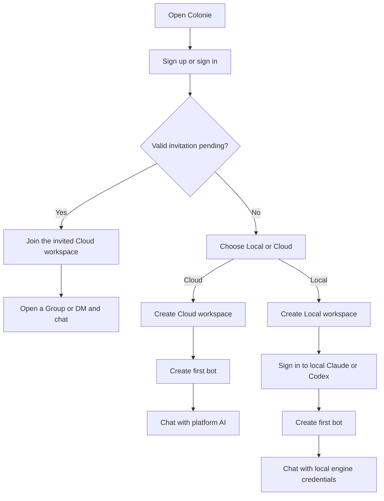
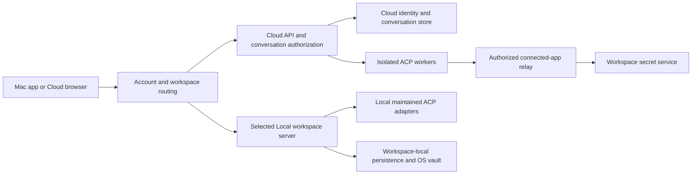

# Colonie workspace product and implementation plan

## Owner correction — preserve the existing UI (October 15)

The owner rejected the separate 0.2.0 Cloud shell after installing it. Account,
workspace and collaboration features must extend the existing Colonie UI; they
do not authorize a redesign. Restore the existing Sidebar, ChatView, avatars,
glass surfaces, chat bubbles and composer as the base for Cloud as well as
Local. Add only controls required for the new account/workspace behavior.
Do not call chat functional until an invited member can actually send, receive
and see messages, and a real AI request succeeds separately. The owner reported
AI errors and inability to chat with the joined team; both need evidence.

Status: implementation authorized, October 14, 2026. After reviewing the
direction, the owner supplied infrastructure credentials and explicitly asked
to proceed with all work. Suitable code and isolated tests are delegated to
DeepSeek through Herdr; infrastructure credentials remain with the lead.
Confirmed decisions below come from the owner's conversation. Proposed defaults
are being used where needed; actual verification is recorded in PROGRESS.md.

October 15 implementation update: the core 0.2.0 beta is deployed. Cloud uses
Better Auth email/password sessions and Neon PostgreSQL, with one-time recovery
keys instead of SMTP. Per-workspace secret references use AES-256-GCM and
server-held encryption keys. Local roots, native provider state and OS vaults
are account-scoped on the Mac. Connected Cloud apps use explicit read-action
leases; sends/edits/deletes are unavailable. A conservative Group-only selector
is in place; no Jev request was made. Automatic Composio provisioning is a
background hook when an org key is configured; this deployment has none.
See RELEASE-0.2.0.md for current journeys and PROGRESS.md for evidence and limits.
The planning register below remains historical context, not a claim that every
proposed provider or deferred feature has been implemented or verified.

## Product direction

Colonie is a shared workplace where people and AI bots are workspace members.
The collaboration model resembles Slack; everyday conversations use **Groups**,
with a familiar group-chat experience. People can send private DMs to other
people or to bots. The primary audience is nontechnical.

One Colonie account can belong to multiple workspaces and create more
workspaces. **Local or Cloud is a property of each workspace.** A person can
use both kinds in the same Mac app.

| Confirmed decision | Required behavior |
| --- | --- |
| Account comes first | First-time Mac onboarding starts with signup. Returning users can sign in. |
| No confirmation-email prerequisite | Signup proceeds without requiring email verification or owner-managed SMTP setup. |
| Self-serve creation | A person who signs up without an invitation can create a workspace. |
| Mode chosen on every creation | Every new workspace asks the person to choose Local or Cloud. |
| Cloud AI supplied by platform | Create a Cloud workspace, create the first bot, and chat using platform AI credentials. |
| Local AI supplied by local login | Create a Local workspace, sign in to local Claude/Codex, create the first bot, and chat. |
| Invitations only for Cloud | An invited person enters the target Cloud workspace and uses platform AI without engine setup. |
| Bot is a workspace member | A bot has a workspace-owned identity, profile, role, Group participation, and DMs. |
| Human-to-human DMs | Humans can privately message each other within the same Cloud workspace. |
| Human-to-bot DMs | Humans can privately message a workspace bot. |
| Shared workspace knowledge | Workspace guidance and intentionally shared knowledge can be used by the team; DM content retains its private audience. |
| Credential separation | Each workspace has its own Composio key; people have individual Colonie identities and can connect personal apps. |
| Proactive Group bots | Bots may participate without a mention when useful, while avoiding excessive or duplicate contributions. |
| Direct responses | DMs and direct mentions receive a response; they do not pass through a participation filter. |
| Optional Jev evaluation | Jev is a candidate for Group participation decisions, with selection deferred until evaluation. |

All factory context, default profiles, UI labels, and project documentation use
English (US). User messages and provider responses retain their own language.
App awareness and saved bot persona/SOUL remain enabled by default. Developer
inspection of prompts and transport details stays optional.

## User journeys

An existing account accepts an invitation into its existing workspace list.
An invitation survives signup/sign-in and opens its intended workspace, rather
than sending the person through workspace or bot creation. If that workspace
has no bot yet, human chat remains usable and the owner can finish bot setup.

Creating another workspace repeats the mode choice. Switching workspaces keeps
each workspace's chats, bot roster, settings, unread state, and credentials
separate. Invited members can also create their own workspaces.

Local workspaces are private to one account on one Mac. They support that
person's bots and Groups with bots. Invitations and collaboration with other
humans are Cloud features. A Local workspace does not become remotely shared
when the account signs in on another device.

Cloud workspaces are available in the Mac app and phone/browser UI through
normal account sign-in. No pairing code, server address, or developer inspector
is a required onboarding step. The current IP HTTPS endpoint is a development
deployment detail, not the workspace identity.

## Membership, conversations, and privacy

Use a stable global identity for a human and a workspace-scoped identity for a
bot. Workspace membership determines access; possessing a workspace ID does
not grant it. The same human can have different roles in different workspaces.

| Conversation | Participants and access |
| --- | --- |
| Group | Explicit human and bot members of one workspace. |
| Human DM | Two human members of the same Cloud workspace. No bot receives the conversation by default. |
| Bot DM | One human and one bot from the same workspace. Each human gets a separate private conversation with that bot. |

Owner/admin access to workspace settings does not automatically expose other
people's DMs in the application. Search, unread indicators, attachments, event
streams, exports, prompt construction, and memory retrieval enforce the same
conversation audience as message reads. Bot membership does not grant access
to all conversations in its workspace.

Keep bot personality and shared instructions at workspace scope. Keep native
agent sessions, private memories, and execution context scoped to the
conversation. A bot's private DM with one person must not contribute material
to another person's DM or a Group. Workspace-wide memory must contain material
whose audience is the workspace; Group-only knowledge keeps its Group audience.
Publishing knowledge more widely is a deliberate user action.

Removing a workspace or Group member invalidates affected reads, streams, tool
leases, and queued work. Recheck access immediately before publishing an agent
result. A long-running task cannot retain access solely because it was allowed
when it started.

### Proposed permissions for the first release

These defaults are recommendations for review, not recorded owner decisions.

| Action | Owner | Admin | Member |
| --- | --- | --- | --- |
| Read/write conversations they participate in | Yes | Yes | Yes |
| Start a human or bot DM | Yes | Yes | Yes |
| Create a Group | Yes | Yes | Yes |
| Manage a Group's membership | Group creator/manager | Group creator/manager | Group creator/manager |
| Create/configure a workspace bot | Yes | Yes | No initially |
| Invite/remove workspace members | Yes | Yes | No |
| Manage workspace connections and credential metadata | Yes | Yes | No |
| Connect/manage their own personal app accounts | Yes | Yes | Yes |
| Transfer ownership or remove the workspace | Yes | No | No |

Bot identities cannot sign in as humans, change roles, or manage credentials.
Their operations follow explicit tool grants. The initiating human, executing
bot, connection used, and destination conversation are recorded separately.

## Accounts and invitations

Proposed initial login: email and password through a maintained auth service,
with email verification optional. The owner approved the no-confirmation flow;
the specific provider and login method still need validation.

Do not treat a claimed email address as proof of its ownership. Proposed
invitations use normal shareable links: an admin creates a revocable, expiring
invitation, and the authenticated recipient accepts it into their account.
Membership is granted by a valid invitation or an authorized member-management
action, never merely by matching a signup email to an address on a list.
Email-restricted invitations would require an ownership-proof mechanism.

Store invitation secrets as hashes. Acceptance is transactional and retry-safe;
revocation, expiry, duplicate acceptance, and already-member states have clear
outcomes. Link sharing is the initial delivery mechanism, so invite creation
does not require an email-sending integration.

Account recovery is a release requirement. Prefer managed recovery delivery
that does not require the owner to configure SMTP. Workspace administrators
cannot reset another member's global account merely because they administer
one of that person's workspaces. Recovery implementation remains a validation
item, not an assumed capability of the current fork.

## Credentials and connected apps

| Credential or connection | Owner and location | Application exposure |
| --- | --- | --- |
| Colonie sign-in | Human account; maintained auth system | Session state and public profile only. |
| Cloud AI access | Platform; trusted runtime/credential service | Members select a bot and chat. Platform secrets are not sent to the renderer. |
| Local Claude/Codex login | Local user; native provider-owned state in the selected Local workspace | Native sign-in flow and status; no cloud upload of local provider credentials. |
| Composio project key | One workspace; Cloud secret service or Local OS-encrypted vault | Owner/admin sees connection status and masked metadata. |
| Personal connected app | A human within a workspace; provider/Composio manages its auth | Only the owner and explicitly granted operations can use it. |
| Shared connected app | Workspace-owned service identity; explicit bot/audience grants | Eligible members and bots use the approved connection without receiving its tokens. |

Cloud provisioning should create a Composio project and project key for each
workspace automatically. Local provisioning should use an explicit,
workspace-scoped connection setup. Neither path makes Composio configuration
a prerequisite for a plain first bot conversation.

The proposed project-per-workspace boundary matches Composio's project resource
isolation. Project provisioning uses organization-level credentials held only
by the provisioning service. [Composio projects](https://docs.composio.dev/reference/v3/api-reference/projects).

Choose stable Composio identities from workspace and principal IDs, not email
or display names. Separate human identities from a workspace's shared service
identity. Composio stores connected-account tokens; Colonie stores connection
IDs, ownership, audience grants, and status. Personal connections remain private
until explicitly shared. Vendor shared-account ACL fields are experimental,
so application enforcement must not depend exclusively on them.
[Composio connected accounts](https://docs.composio.dev/reference/v3/api-reference/connected-accounts).

Resolve every tool request against the workspace, actor, bot, conversation
audience, selected connection, and current grant. Group proactivity can use
approved workspace connections; it cannot choose a member's personal account
as a convenient fallback. Personal results cannot be posted into a broader
audience merely because the bot can fetch them.

Cloud secrets are encrypted at rest with encryption keys held outside the
database. Local secrets retain OS encryption and gain workspace-specific slots.
Credential changes are atomic, versioned, and revocable. Failed validation or
an unavailable vault preserves the existing working configuration. Raw keys
stay out of ordinary config responses, messages, prompts, diagnostics, and
agent-facing tool results. Cache and lease identities include workspace,
principal, credential version, and grant revision.

### The reported Composio key error

The owner's error says `POST /api/v3.1/tool_router/session` requires
`session_management` write access while the submitted key has read access.
Source inspection confirms `validateProjectKey` creates a session with that
POST before returning a usable configuration. This is a provider permission
failure; it does not prove the encrypted storage itself failed.

Plan a separate compatibility fix: distinguish insufficient permissions from
storage failures, retain the old credential when validation fails, and show an
actionable explanation. Fixture validation must cover read-only and usable
keys. Real validation requires a correctly scoped project key supplied through
the application's intended setup flow. No real key was inspected or changed
for this planning document, and the complete least-privilege permission set
has not yet been established.

## Proposed architecture

Reuse the maintained ACP SDK and `codex-acp` / `claude-acp` adapters. Preserve
useful Electron, UI, HTTP/SSE, persistence, and connected-tools infrastructure.
Do not adopt the legacy ACP client, native Codex driver, retired enterprise
layer, or upstream personas/automation behavior as the execution foundation.

### Data placement and ownership

Recommended starting point: Neon Postgres for Cloud account references,
workspace membership, conversation membership, messages, connection metadata,
and job/event records. Keep Local conversations and provider state on the Mac.
Keep attachment/file bytes in scoped file/object storage with database metadata.
Native provider transcripts and process state remain in isolated runtime
storage rather than becoming the application source of truth.

Cloud collaboration needs one authoritative conversation store that supports
durable sender identity, independent unread state, ordered events, and
transactional membership changes. Preserve the existing Local persistence
behind a repository interface; do not migrate all Local data to Postgres as a
side effect of adding account signup.

Core entities to design before migrations:

| Entity | Important ownership or invariant |
| --- | --- |
| Account | Stable global human ID; credentials managed by auth. |
| Workspace | Stable ID, Local/Cloud kind, owner, provisioning state. |
| Workspace membership | Unique account/workspace pair and role. |
| Workspace principal | Human membership or bot identity; used as a message sender. |
| Conversation | Exactly one workspace; Group or DM type. |
| Conversation membership | Participants, grants, and history visibility. |
| Message | Workspace/conversation/sender identity, stable ID and order. |
| Read cursor | Per human and conversation; never a shared unread flag. |
| Connection and grants | Workspace, owning principal, toolkit, provider account ID, allowed audience/actions. |
| Secret reference | Encrypted secret reference, version and status; restricted access. |
| Bot run and native session | Workspace, bot, conversation, initiator, model, status, scoped runtime. |
| Memory item | Workspace plus its permitted audience and source provenance. |
| Invitation and event | Revocable membership invitation; durable authorized event delivery. |

Use database constraints and authorization checks to prevent cross-workspace
references. RLS can provide a second boundary, but backend authorization remains
mandatory. A bot worker has no unrestricted database connection or platform
secret-store access. Existing origin-scoped desktop server entries need explicit
workspace IDs because multiple Cloud workspaces can share one platform origin.

### Auth candidate: Neon Managed Better Auth

Neon's current managed auth stores users and sessions in Postgres and supports
isolated auth branches. Its email-verification setting can be optional, allowing
immediate sign-in. These documented capabilities fit the proposed account flow.
[Neon overview](https://neon.com/docs/auth/overview),
[optional email verification](https://neon.com/docs/auth/guides/email-verification).

Neon remains a candidate, not an installed dependency. Validate ordinary
email/password signup, session handling on the Mac app and browser, the current
IP HTTPS origin, Local loopback origins, signout, recovery delivery, and trusted
redirects in a disposable environment. Managed recovery is documented through
email links; its actual delivery and application integration still need a
check. [Neon recovery](https://neon.com/docs/auth/guides/password-reset).

### Runtime privacy and platform AI

Workspace folders and application permission checks alone are insufficient
isolation for agents that can execute native tools. Cloud execution must isolate
workspace resources and private conversation state at the filesystem, process,
and tool-relay boundaries. Native homes/session files from one DM must not be
readable by another conversation's agent tools. Shared resources enter through
explicitly authorized mounts or services.

The platform AI funding model is confirmed; the working provider-auth mechanism
is not. Before committing a runtime design, perform a bounded maintained-ACP
spike with platform-funded inference. Prove how provider authentication reaches
the native runtime while preventing tool/shell subprocesses from obtaining
unrestricted platform credentials. Evaluate scoped credentials or an
authenticated inference proxy where the provider/adapter supports it. Do not
assume today's single owner's CLI login is the credential architecture for
public self-serve Cloud workspaces.

Record the exact application-authored prompt before dispatch, as today. Native
system/project instructions remain provider-owned. Bot persona and approved
workspace context enter through the existing independent ACP context boundary.

## What the current source actually supplies

These are source observations, not claims of new workflow verification.

| Existing source | Reuse and gap |
| --- | --- |
| `electron/colonie.mjs`, `electron/colonie-config.mjs` | One active Local data root; legacy paths are intentionally reused to preserve native absolute working directories. Needs a Local workspace registry. |
| `electron/environments.cjs`, `electron/main.mjs` | Remote origin navigation and native workspace-menu infrastructure already exist. The remote branch at main.mjs's main-window load path contradicts the older handover shorthand that all navigation is unconditionally local. Audit and adapt the existing machinery. |
| `src/components/onboarding/WelcomeFlow.tsx` | Existing welcome/engine/permission/bot beats and hosted variation. Add the account and per-workspace journeys around reusable beats. |
| `server/config.ts` | One `DATA_DIR` and global configuration per process; no established multi-tenant account routing. |
| `server/acp/profile.ts` | Provider state isolated under the app's native root; needs workspace/conversation-aware runtime boundaries. |
| `server/store.ts`, `shared/wire.ts` | Existing Groups are bot-oriented; `dm` describes bot-to-bot rooms and persisted members are checked against bot IDs. Human membership/DM semantics require explicit schema and API changes. |
| `electron/secure-credentials.mjs`, `electron/credential-persistence.mjs` | OS-encrypted credential handling, unavailable-versus-empty state, atomic persistence and rollback. Preserve these guarantees. |
| `server/colonie/connections/credential-status.ts` | Masked owner/admin credential metadata exists. Its scope currently comes from one application config. |
| `server/colonie/connections/manager.ts`, `server/index.ts` | Scoped ACP tool leases exist, but credentials are supplied from one global Composio key/user ID. Add workspace, human identity, connection and audience authorization. |
| `server/composio.ts` | Key validation creates a session and exposes the reported permission failure. Separate validation errors from persistence errors. |

The already observed Linux Codex turn and TLS/pairing fixtures remain useful
deployment evidence. They do not prove accounts, multiple workspaces,
human-to-human DMs, private multi-user memory, or public platform-funded AI.

## Implementation sequence and acceptance evidence

Every milestone uses disposable Local directories and isolated Cloud/database
fixtures. Simulated, real-provider, renderer, and packaged-desktop results are
recorded separately in PROGRESS. No milestone passes on compilation or health
responses alone.

| Milestone | Deliverable and dependencies | Required evidence |
| --- | --- | --- |
| P0: contracts and feasibility | Ratify proposed permissions/history/recovery defaults; define workspace/actor/conversation contracts; auth and platform-funded ACP feasibility probes. | Disposable signup without confirmation, session isolation, recovery feasibility, and a bounded real ACP turn with the proposed platform auth boundary. No production signup or credentials changes. |
| P1: identity and workspace boundaries | Account service, Cloud workspace/membership/invitation tables, Local registry, authorization, persistence adapters and migration fixtures. Requires P0 decisions. | One account owns and joins different workspaces; valid invite joins the intended workspace; other identities cannot read it. Cross-workspace requests and streams fail. |
| P2: desktop onboarding and switching | Both workspace-creation journeys, invitation continuation through auth, resume/relaunch behavior, workspace switching. Requires P1; provider execution uses controlled stand-ins until P5. | Renderer and packaged Mac runs complete each journey without technical setup in Cloud, retain the right invitation, and never mix Local/Cloud state. |
| P3: human and bot conversations | Human principals, Groups, human-human and human-bot DMs, per-user unread state and durable HTTP/SSE replay. Requires P1/P2. | Two humans exchange messages and reconnect; a third participant cannot read/subscribe/search the DM. Same bot's DMs and Group context remain separate. |
| P4: workspace connections | Cloud secret service, Local workspace vault slots, project-per-workspace provisioning, personal/shared connection grants, precise permission errors. Requires P1/P3 boundaries. | Two fixture workspaces use distinct keys; wrong identities/grants fail; key rotation revokes stale leases; read-only Composio key preserves the prior configuration and gives an actionable error. Real Composio check remains separate. |
| P5: end-to-end ACP work | Attach isolated Cloud workers and Local native adapters to the collaboration contracts; preserve streaming, approval, Stop, receipts, profile defaults and native session ownership. Requires P0/P3/P4. | Real bounded turns complete in each mode; owner-invited person chats without engine setup; restart resumes the correct conversation; revoked access cannot publish a result. Test tool permissions and secret isolation separately. |
| P6: considerate Group participation | Evaluate Jev and a simpler baseline on permitted, labeled conversation examples; add Group-only participation policy. Requires P3/P5. | Useful proactive contributions without duplicate/bot loops; DM/direct mentions still respond; completed work follows up; uncertain participation can remain silent. No model choice assumed before evaluation. |
| P7: release journeys | Existing-install compatibility, mobile Cloud layout, installable Mac artifact, download delivery and migration/recovery runbook. Requires the complete journeys above. | Fresh signup-to-chat in Cloud and Local, invite-to-chat, human DMs, isolation and workspace switching pass in the packaged app; owner independently confirms phone use. Verify published artifact/download separately. |

Implementation slices are allowed; the complete planned release includes both
self-serve signup and invitations, both workspace modes, and human DMs. A
partial internal milestone is not described as the finished product.

### Participation detail intentionally deferred

Jev is a candidate for choosing whether and which bot participates in a Group.
Its model, confidence thresholds, timing, and conversational style are not
locked here. DMs and direct mentions bypass participation selection. A bot that
takes a task can acknowledge real work and follow up with the result. The
choice to speak does not expand its tool permissions. Use only the Group's
authorized context when evaluating participation.

The vendor describes structured decisions and Vercel exposes Jev as an
evaluation model. This supports evaluating the fit; no live Jev call has been
made. [TypeSafe](https://typesafe.ai/blog/introducing-system-one-models-and-jev),
[Vercel model](https://vercel.com/ai-gateway/models/jev).

## Migration and deferred scope

Register existing Local data as an initial Local workspace in place. Preserve
its absolute paths, native sessions, bot IDs, and credential custody. New Local
workspaces get isolated roots and vault entries. Verify upgrades and rollback
with synthetic legacy data before touching a real installation.

The existing VPS's data needs an explicit ownership mapping before Cloud
migration. Public signup does not claim an existing installation by default.
Pairing-session labels do not become global human identities automatically.
Keep deployment/bootstrap compatibility while introducing ordinary account
login; do not force pairing back into the default product flow.

Workspace mode conversion, cross-workspace forwarding, bot-to-bot DMs as a
public feature, pricing/payment design, spend caps, and broad upstream cleanup
are outside this plan's implementation slices unless separately requested.
Existing deferred features remain deferred except those the owner explicitly
reopened: multi-workspace identity/permissions and Group collaboration.

## Review register and next action

| Item | Planning position |
| --- | --- |
| Signup, invitation, mode, platform/local AI, human DMs | Confirmed by owner; implement both complete journeys. |
| Email/password and Neon managed auth | Proposed; validate in P0 without changing the no-confirmation requirement. |
| Member-created Groups and admin-created bots | Proposed initial permission defaults; owner can revise before P1 contracts are frozen. |
| Group history on membership changes | Pending; propose visibility from joining, with explicit prior-history sharing. Bot memory follows the same audience rule. |
| Account recovery without owner SMTP setup | Release requirement; validate managed delivery and origin handling in P0. |
| Platform-funded maintained-ACP credential isolation | Required feasibility evidence before Cloud runtime implementation; provider mechanism still open. |
| Per-workspace Composio project/key provisioning | Proposed implementation of confirmed credential separation; complete provider permission set and provisioning access unverified. |
| Jev selection and detailed bot etiquette | Deferred evaluation; no credential needed for this planning session. |

Next action is review of the proposed defaults and P0 contracts/probes. This
document contains no completed-feature claim. No new app/server, database,
provider-auth, Composio or Jev workflow was executed during its preparation.
